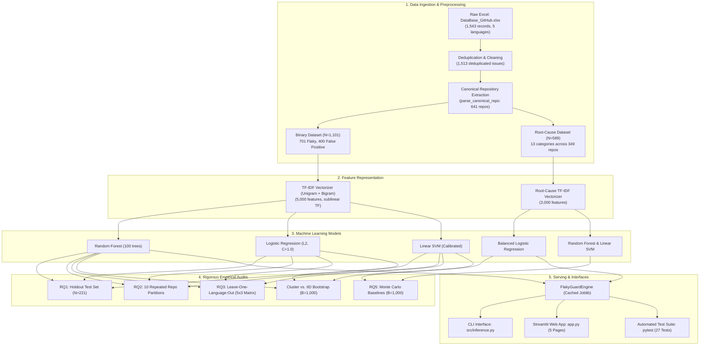
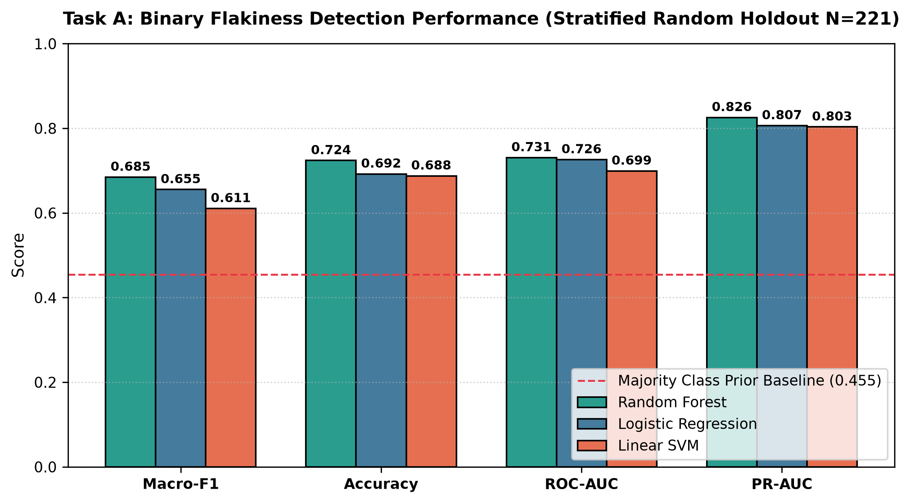
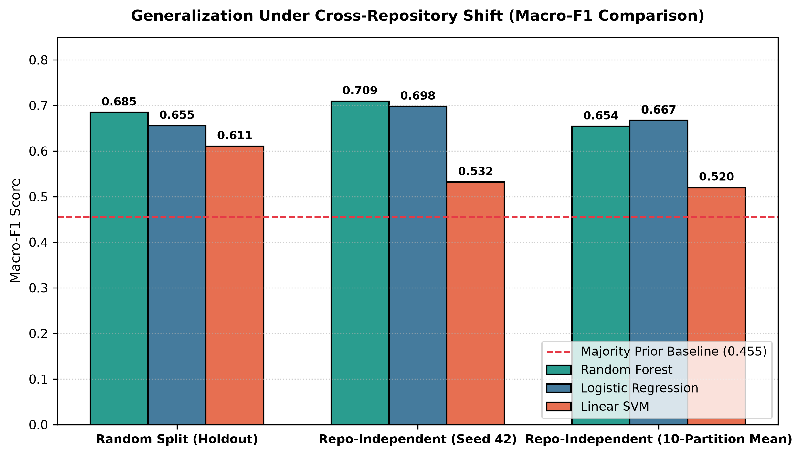
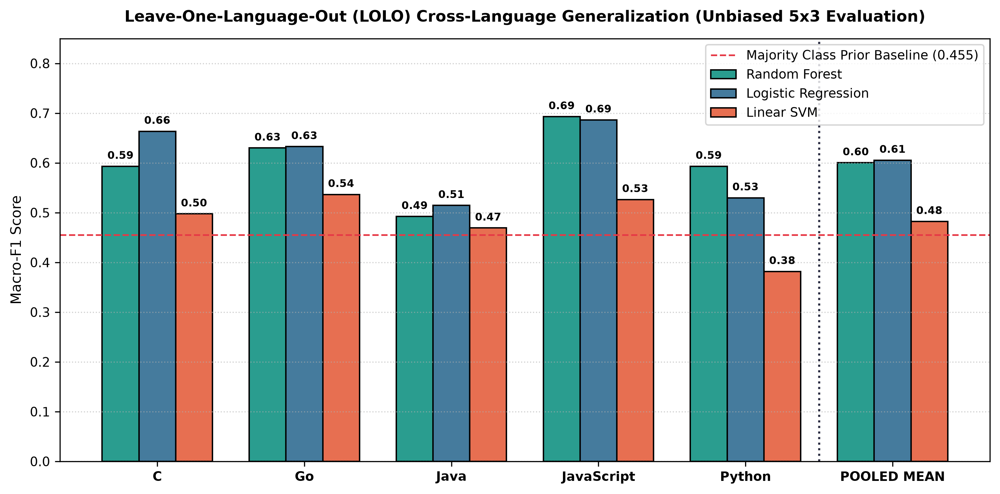
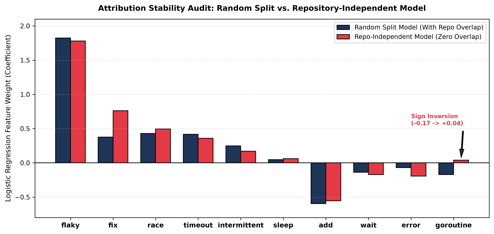
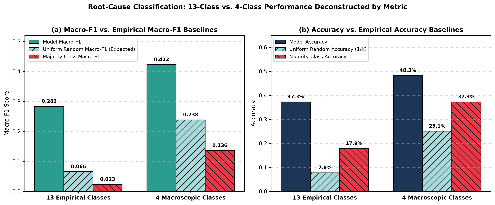

# FlakyGuard AI: Explainable Machine Learning for Flaky Test Detection & Root-Cause Classification

[](https://www.python.org/)
[](LICENSE)
[](https://streamlit.io/)
[](https://scikit-learn.org/)
[](tests/)

**FlakyGuard AI** is an empirical software engineering research framework and explainable machine learning system designed to analyze developer-written GitHub issue reports related to software test flakiness. The system evaluates:
1. **Binary Flakiness Detection (Task A)**: Distinguishing genuine non-deterministic test flakiness ($Y=1$) from false-positive / deterministic bug reports ($Y=0$).
2. **Root-Cause Taxonomy Classification (Task B)**: Categorizing verified flaky issues across 13 empirical failure categories and 4 macro categories.
3. **Generalization Boundaries**: Assessing model performance across unseen software repositories and previously unobserved programming languages.
4. **Attribution Faithfulness**: Investigating whether post-hoc token explanations remain directionally stable under distribution shift.

The project builds upon the empirical benchmark published by:
> **"Test Flakiness Across Programming Languages"**  
> Keila Barbosa, Ronivaldo Ferreira, Gustavo Pinto, Marcelo d'Amorim, and Breno Miranda  
> *IEEE Transactions on Software Engineering (TSE)*, Vol. 49, No. 4, pp. 2074–2095, 2023.  
> Official Benchmark Repository: [https://github.com/Test-Flaky/TSE22](https://github.com/Test-Flaky/TSE22)

---

## 1. Research Motivation

In modern continuous integration (CI/CD) pipelines, automated tests execute thousands of times daily. **Flaky tests**—tests that non-deterministically pass and fail on identical source code—destroy developer trust in automated test suites, waste expensive compute hours on re-runs, and cause engineers to dismiss real regression failures.

While prior research has largely evaluated flakiness inside isolated Java execution environments, software test flakiness manifests across multiple ecosystems (C, Go, Java, JavaScript, Python) with distinct architectural patterns (e.g. Go goroutine deadlocks vs. JavaScript event-loop timeouts). When developers file bug reports discussing flakiness, over **36% of these reports represent false positives** (deterministic bugs, environment misconfigurations, or documentation inquiries). Automated, explainable triage tools are needed to assist engineering teams in categorizing and prioritizing these issues.

---

## 2. Problem Statement

Given a developer-written GitHub issue report $x = \{\text{title}, \text{body}, \text{language}\}$, predict:
1. Whether $x$ represents an authentic flaky test failure ($y \in \{0, 1\}$).
2. The root cause $c \in \{1, \dots, 13\}$ among verified flaky reports.
3. The specific tokens driving the prediction, while determining the robustness of these attributions when the model is evaluated on **previously unseen repositories** and **unseen programming languages**.

> [!IMPORTANT]
> **Operational Scope Notice**: FlakyGuard AI triages natural language issue text and pull request discussions. It does **not** inspect dynamic runtime thread interleavings, JVM bytecode, or raw OS memory access traces.

---

## 3. Research Objectives

1. Develop a reproducible, zero-leakage classical ML pipeline for binary detection and root-cause classification.
2. Quantify the generalization penalty when models are evaluated on unseen software repositories (`GroupShuffleSplit`).
3. Evaluate cross-language transfer across five language ecosystems using Leave-One-Language-Out (LOLO).
4. Conduct an attribution stability audit to measure whether feature attributions remain consistent under distribution shift.
5. Provide a usable CLI and an interactive Streamlit dashboard for real-time diagnostic evaluation.

---

## 4. Research Questions (RQ1–RQ5)

- **RQ1 (In-Distribution Detection)**: How accurately can classical ML models distinguish genuine test flakiness from false positives in developer-written issue reports under in-distribution holdout conditions?
- **RQ2 (Repository-Independent Generalization)**: To what extent does binary flakiness detection performance degrade when models are evaluated on previously unseen software repositories?
- **RQ3 (Cross-Language Generalization)**: How effectively do flaky test detection models generalize across programming language boundaries under a Leave-One-Language-Out (LOLO) regime?
- **RQ4 (Attribution Stability Under Shift)**: Do post-hoc token attributions remain directionally stable when models transition from overlapping repositories to repository-independent splits?
- **RQ5 (Root-Cause Taxonomy Granularity)**: How does classification performance vary between a 13-class fine-grained root-cause taxonomy and a 4-class consolidated macro taxonomy when compared against empirical random baselines?

---

## 5. System Architecture



---

## 6. Dataset Description

The dataset is derived from Barbosa et al. (*IEEE TSE 2023*) and contains issues from **C, Go, Java, JavaScript, and Python**:

| Dataset Stage | Total Samples | Flaky ($Y=1$) | False Positive ($Y=0$) | Canonical Repositories | Purpose |
| :--- | :---: | :---: | :---: | :---: | :--- |
| **Raw Excel (`Data`)** | 1,543 | 719 | 400 | 850 | Initial collection |
| **Deduplicated** | 1,513 | 703 | 400 | 842 | Exact duplicate pruning |
| **Binary Detection** | **1,101** | **701** (63.7%) | **400** (36.3%) | **641** | Task A: Binary Classification |
| **Root-Cause Taxonomy** | **589** | **589** (100%) | — | **349** | Task B: 13-Class Classification |

*Note on Repository Count*: The raw Excel tab `ProjectsDomain` row 2 defines 421 as projects containing $\ge 1$ flaky issue under author domain criteria. The binary dataset contains **641 unique canonical repositories** resolved via URL regex parsing.

---

## 7. Data Preprocessing Methodology

1. **Header Normalization**: Columns mapped to `issue_id`, `url_issue`, `title`, `body`, `language`, `flakiness_status`, `root_cause_category`.
2. **Canonical Repository Extraction**: `parse_canonical_repo` parses `{owner}/{repo}` from issue URLs, resolving 192 rows with empty repository fields.
3. **Target Leakage Prevention**: Reviewer annotations (`Reviewer 1`, `Reviewer 2`, `Fix Strategy`, `Solution Description`) are strictly excluded.
4. **Text Concatenation**: Features are formed by combining normalized language, title, and body: `"{language} {title} {body}"`.
5. **Strict Vectorizer Isolation**: In all generalization experiments, TF-IDF vectorizers are fitted **exclusively** on the training partition.

---

## 8. Machine Learning Algorithms

- **Random Forest**: 100 trees, Gini impurity criterion, max depth unconstrained, parallelized (`n_jobs=-1`).
- **Logistic Regression**: L2 regularization, $C=1.0$, balanced class weights, liblinear / lbfgs solver.
- **Linear Support Vector Machine (Linear SVM)**: Linear kernel, squared hinge loss, calibrated via Platt scaling (3-fold `CalibratedClassifierCV`) to output well-calibrated probabilities.

---

## 9. Experimental Methodology

1. **In-Distribution Holdout (RQ1)**: Stratified 80/20 train/test split ($N=880$ train, $N=221$ test, seed 42).
2. **Repository-Independent Generalization (RQ2)**: 10 repeated partitions via `GroupShuffleSplit` (test size = 0.20, seeds `[42..909]`). Zero repository overlap is strictly enforced: $\text{Train Repos} \cap \text{Test Repos} = \emptyset$.
3. **Cross-Language Generalization (RQ3)**: Leave-One-Language-Out (LOLO) across 5 languages ($5 \times 3$ unbiased matrix).
4. **Attribution Stability Audit (RQ4)**: Tracking coefficient shifts for 10 curated tokens between random-split and repository-independent training regimes.
5. **Root-Cause Taxonomy Granularity (RQ5)**: Comparing 13 fine-grained classes against 4 macro categories with 1,000 Monte Carlo baseline trials.
6. **Cluster Bootstrap**: $B=1,000$ resamples at the repository cluster level to estimate cluster-robust standard errors.

---

## 10. Evaluation Metrics

Because of class imbalance (63.7% Flaky vs. 36.3% False Positive in Task A; 17.8% `Async Wait` vs 0.85% `Test Suite Timeout` in Task B), **Macro-Averaged F1-Score (Macro-F1)** serves as the primary evaluation metric:
$$\text{Macro-F1} = \frac{1}{K} \sum_{k=1}^K F_1^{(k)}$$
Models are also evaluated on **Accuracy**, **Precision**, **Recall**, **ROC-AUC**, and **PR-AUC**.

---

## 11. Key Experimental Results

### RQ1: In-Distribution Binary Detection ($N=221$ Test Set)

| Model | Accuracy | Precision | Recall | F1 (Flaky) | Macro-F1 | ROC-AUC | PR-AUC |
| :--- | :---: | :---: | :---: | :---: | :---: | :---: | :---: |
| **Random Forest** | **72.40%** | **0.7516** | 0.8429 | **0.7946** | **0.6848** | **0.7310** | **0.8258** |
| **Logistic Regression** | 68.33% | 0.7397 | 0.7714 | 0.7552 | 0.6558 | 0.7161 | 0.8123 |
| **Linear SVM** | 67.87% | 0.7315 | 0.7786 | 0.7543 | 0.6489 | 0.7118 | 0.8068 |
| *Majority Class Baseline* | 63.35% | 0.6335 | **1.0000** | 0.7756 | 0.4550 | 0.5000 | 0.6335 |



### RQ2: Repository-Independent Generalization (10 Repeated Partitions)

| Model | Mean Macro-F1 $\pm$ Std | Min Macro-F1 | Max Macro-F1 | In-Distribution Macro-F1 | Generalization Gap |
| :--- | :---: | :---: | :---: | :---: | :---: |
| **Logistic Regression** | **0.6670 $\pm$ 0.0239** | 0.6268 | 0.6975 | 0.6558 | **$+0.0112$** |
| **Random Forest** | **0.6542 $\pm$ 0.0267** | 0.6098 | 0.6853 | 0.6848 | **$-0.0306$** |
| **Linear SVM** | **0.5201 $\pm$ 0.0546** | 0.4429 | 0.5985 | 0.6489 | **$-0.1288$** |



### RQ3: Cross-Language Generalization (LOLO Matrix)

| Held-Out Language | Test Samples ($N$) | Logistic Regression Macro-F1 | Random Forest Macro-F1 | Linear SVM Macro-F1 |
| :--- | :---: | :---: | :---: | :---: |
| **JavaScript (`js`)** | 265 | **0.6929** | **0.6918** | 0.5898 |
| **Go (`go`)** | 192 | 0.6120 | 0.6472 | 0.4190 |
| **C (`C`)** | 211 | 0.6083 | 0.5714 | 0.5034 |
| **Python (`python`)** | 222 | 0.5989 | 0.5756 | 0.4308 |
| **Java (`java`)** | 211 | **0.5144** | **0.5149** | 0.4682 |
| **Language-Mean $\pm$ Std** | — | **0.6053 $\pm$ 0.0785** | **0.6002 $\pm$ 0.0729** | **0.4822 $\pm$ 0.0621** |
| **Pooled LOLO ($N=1,101$)** | 1,101 | **0.6539** | **0.6588** | **0.5408** |



### RQ4: Explainability & Attribution Stability

- **Sign Invariance**: Evaluated on 10 curated tokens under Logistic Regression, **9/10 (90%) maintained directional sign** across repository shift (`flaky`, `timeout`, `race`, `intermittent`, `sleep`, `wait`, `error` remained $+$; `fix`, `add` remained $-$).
- **Distribution-Induced Polarity Shift**: The Go-specific token `goroutine` inverted sign ($-0.1708 \rightarrow +0.0387$), demonstrating that repository clustering can alter token polarity for domain-specific keywords.
- **Tree MDI Non-Negativity**: Random Forest Mean Decrease in Impurity (Gini importance) is mathematically non-negative ($\ge 0$) and cannot indicate direction.



### RQ5: Root-Cause Granularity & Empirical Baselines

| Taxonomy Setting | Best Model | Accuracy | Macro-F1 | Uniform-Random Macro-F1 | Macro-F1 Lift over Baseline | Accuracy Lift over Baseline |
| :--- | :--- | :---: | :---: | :---: | :---: | :---: |
| **13 Fine-Grained Classes** | **Random Forest** | **37.29%** | **0.2834** | 0.0655 | **$4.33\times$** | **$4.81\times$** |
| **4 Macro Categories** | **Logistic Regression** | **48.31%** | **0.4222** | 0.2383 | **$1.77\times$** | **$1.93\times$** |



---

## 12. Repository Structure

```text
AI-Based Flaky Test Detection/
├── README.md                               # Project documentation & benchmark overview
├── app.py                                  # Streamlit web dashboard entry point
├── pytest.ini                              # Pytest configuration
├── requirements.txt                        # Pinned dependencies
├── artifacts/
│   ├── figures/                            # Diagnostic EDA and confusion matrices
│   │   ├── explainability/                 # SHAP and LIME visual explanations
│   │   └── publication/                    # 10 publication-quality 300 DPI figures
│   └── metrics/                            # Evaluation reports, CSVs, and audit logs
├── data/
│   ├── DATASET_DOCUMENTATION.md            # Raw dataset provenance documentation
│   ├── raw/                                # Raw Excel and scraped JSON issue metadata
│   └── processed/                          # Cleaned, deduplicated CSV datasets
├── docs/
│   ├── PROJECT_ARCHITECTURE.md             # Complete architecture and execution flow
│   ├── EXECUTION_GUIDE.md                  # Step-by-step execution manual
│   ├── DATASET_DOCUMENTATION.md            # Comprehensive dataset documentation
│   ├── MODEL_EVALUATION_REPORT.md          # Full empirical evaluation tables (RQ1–RQ5)
│   ├── REPRODUCIBILITY_GUIDE.md            # Deterministic reproduction instructions
│   ├── TECHNICAL_VALIDATION_REPORT.md      # Code quality, leakage audit, and test report
│   ├── RESEARCH_PAPER_VALIDATION_REPORT.md # Line-by-line paper scientific integrity audit
│   ├── KNOWN_LIMITATIONS.md                # Threat analysis and boundary scope
│   ├── FACULTY_DEFENSE_QA.md               # 44 challenging supervisor/reviewer Q&As
│   └── research/                           # Research manuscript and faculty reviews
│       ├── FLAKYGUARD_AI_RESEARCH_PAPER.md # Complete research manuscript
│       ├── FLAKYGUARD_FINAL_FACULTY_REVIEW.md # Final reviewer-level evaluation report
│       └── teacher_presentation_outline.md# Academic presentation deck outline
├── models/                                 # Serialized vectorizers and trained models
├── notebooks/                              # Jupyter exploratory notebooks
├── pages/                                  # Streamlit multi-page application modules
├── src/                                    # Core source code modules
│   ├── data_acquisition.py                 # Dataset loading and verification
│   ├── data_preprocessing.py               # Cleaning, deduplication, and canonical parsing
│   ├── feature_engineering.py              # TF-IDF vectorization pipelines
│   ├── flaky_detection.py                  # Binary classification training
│   ├── root_cause_classifier.py            # 13-class taxonomy training
│   ├── repository_generalization.py        # Grouped repository evaluation
│   ├── repeated_repository_evaluation.py   # 10 repeated GroupShuffleSplit partitions
│   ├── lolo_evaluation.py                  # Leave-One-Language-Out framework
│   ├── root_cause_baselines.py             # Monte Carlo empirical baseline simulator
│   ├── confidence_intervals.py             # Cluster and IID bootstrap analysis
│   ├── explainability.py                   # Token contribution algorithms
│   ├── explainability_audit.py             # Attribution stability experiments
│   ├── publication_figures.py              # Publication figure generator
│   └── inference.py                        # Standalone CLI and cached serving engine
└── tests/                                  # 27 automated unit and integration tests
```

---

## 13. Installation Instructions & Environment Setup

```bash
# 1. Clone repository
git clone <repository_url>
cd "AI-Based Flaky Test Detection"

# 2. Create virtual environment
python3 -m venv .venv
source .venv/bin/activate

# 3. Install dependencies
pip install -r requirements.txt

# 4. Set environment variables
export PYTHONPATH=.
export MPLCONFIGDIR=/tmp/mpl
```

---

## 14. How to Execute the Project

### Command-Line Interface (CLI):
```bash
# Basic Flakiness Diagnosis
python src/inference.py \
  --title "TestNetworkTimeout fails intermittently" \
  --description "Connection timeout after 5000ms waiting for heartbeat" \
  --language "Python"

# Diagnostic with Root-Cause Prediction & JSON Output
python src/inference.py \
  --title "Goroutine deadlock" \
  --description "Channel block during stress testing" \
  --language "Go" \
  --root-cause \
  --json
```

### Streamlit Web Application:
```bash
streamlit run app.py
```
Open your browser to `http://localhost:8501`.

---

## 15. How to Reproduce Experiments

Execute the deterministic reproduction pipeline:
```bash
# 1. Preprocess raw dataset
python src/data_preprocessing.py

# 2. Train and evaluate binary models (RQ1)
python src/model_training.py
python src/evaluation.py

# 3. Train root-cause models and compute empirical baselines (RQ5)
python src/root_cause_classifier.py
python src/root_cause_baselines.py
python src/root_cause_validation.py

# 4. Run repeated repository generalization (RQ2)
python src/repeated_repository_evaluation.py

# 5. Run Leave-One-Language-Out evaluation (RQ3)
python src/lolo_evaluation.py

# 6. Run statistical cluster bootstrap
python src/confidence_intervals.py

# 7. Run explainability attribution audit (RQ4)
python src/explainability_audit.py

# 8. Regenerate publication figures
python src/publication_figures.py
```

---

## 16. How to Run Automated Tests

Run all 27 automated tests:
```bash
pytest tests/ -v
```
Expected result: **27 passed in ~2.3 seconds**.

---

## 17. Limitations & Threat Analysis

1. **Natural Language Proxy**: Models analyze developer issue descriptions submitted post-hoc. They do not monitor dynamic runtime JVM threads or OS memory allocations.
2. **Lexical Representation**: TF-IDF models word frequencies, discarding long-range syntax and execution grammar in code snippets.
3. **Root-Cause Class Sparsity**: With 589 root-cause issues across 13 classes, minority categories (e.g. `Test Suite Timeout`, $N=5$) have limited training representation.
4. **Attribution Bounds**: Feature weights reflect statistical correlations in developer text, not physical causes of failure.
5. **Language Confounding**: Language boundaries correlate with community sizes and repository maturity, confounding cross-language transfer.

See [`docs/KNOWN_LIMITATIONS.md`](docs/KNOWN_LIMITATIONS.md) for full details.

---

## 18. Future Research Directions

- **Multi-Modal CI Traces**: Combining developer issue text with raw CI execution logs and container telemetry.
- **Context-Aware Embeddings**: Evaluating fine-tuned code-aware language models (e.g. CodeBERT) under strict repository grouping.
- **Automated Triage Actioning**: Connecting predictions to automated CI test retries and quarantine policies.

---

## 19. Citation Information

If using this codebase or research findings in academic work, please cite:

```bibtex
@article{barbosa2023test,
  author    = {Barbosa, Keila and Ferreira, Ronivaldo and Pinto, Gustavo and d'Amorim, Marcelo and Miranda, Breno},
  title     = {Test Flakiness Across Programming Languages},
  journal   = {IEEE Transactions on Software Engineering},
  volume    = {49},
  number    = {4},
  pages     = {2074--2095},
  year      = {2023},
  doi       = {10.1109/TSE.2022.3208864}
}
```

---

## 20. Research Paper & Faculty Review Location

- **Research Manuscript**: [`docs/research/FLAKYGUARD_AI_RESEARCH_PAPER.md`](docs/research/FLAKYGUARD_AI_RESEARCH_PAPER.md)
- **Faculty Review Report**: [`docs/research/FLAKYGUARD_FINAL_FACULTY_REVIEW.md`](docs/research/FLAKYGUARD_FINAL_FACULTY_REVIEW.md)
- **Presentation Deck**: [`docs/research/teacher_presentation_outline.md`](docs/research/teacher_presentation_outline.md)
- **Faculty Defense Q&A (44 Questions)**: [`docs/FACULTY_DEFENSE_QA.md`](docs/FACULTY_DEFENSE_QA.md)
