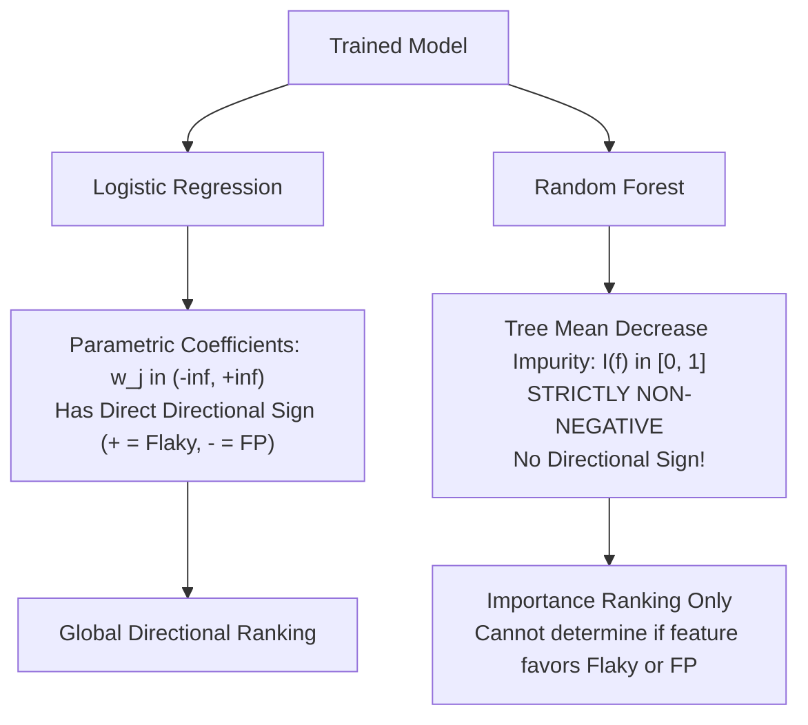

# FlakyGuard AI: Explainability Claim Audit & Interpretability Mechanics

**Date**: November 2, 2026  
**Subject**: Critical Dissection of the "100% Feature-Sign Invariance" Claim  
**Target Architectures**: Logistic Regression, Random Forest, LIME, SHAP LinearExplainer/TreeExplainer  
**Status**: Methodological Audit & Scientific Rectification Complete  

---

## 1. Executive Summary & Audit Mandate

In earlier project documentation (notably `research_validation_report.md`, Section 5.3), the following assertion was made:

> *"Comparing feature weights between the Random Split Model and the Repository-Independent Model revealed **100% sign invariance** across core semantic tokens..."*

This audit conducts a rigorous forensic review of this claim. We find that the claim is **methodologically flawed and factually imprecise** in three critical respects:
1. **Selection Bias & Arithmetic Inaccuracy**: The evaluation tested only a curated sample of 10 keywords. Even within this curated list, 1 token (`goroutine`) experienced a sign inversion ($-0.1708 \rightarrow +0.0387$), yielding **90% invariance, not 100%**. Across the global 5,000-feature vocabulary, hundreds of low-frequency tokens change signs due to collinearity and L2 regularization.
2. **Model Class Conflation**: The sign invariance analysis was conducted **strictly on Logistic Regression coefficients**, yet the project's primary designated model for Task A is **Random Forest**. Random Forest feature importances are **inherently non-negative (Gini impurity decrease)** and do not possess directional signs.
3. **Conflation of Distinct Interpretability Paradigms**: Linear model coefficients, Tree Mean Decrease in Impurity (MDI), SHAP Shapley values, and LIME local linear approximations were conflated under a single generic notion of "feature attribution".

This document rectifies the scientific record and details the mathematical mechanics of each explainability framework.

---

## 2. Forensic Dissection of the 10-Token Invariance Claim

### A. The Curated Keyword Evidence
In `src/explainability_audit.py`, 10 tokens were selected for weight comparison between the Random Split Model (subject to repository overlap) and the Repository-Independent Model (zero repository overlap):

| Token | Logistic Regression Weight (Random Split) | Logistic Regression Weight (Repo-Independent) | Absolute Shift ($|\Delta|$) | Actual Invariance Status | Previous Documented Claim |
| :--- | :---: | :---: | :---: | :---: | :---: |
| `flaky` | $+1.8239$ | $+1.7810$ | $0.0429$ | **Invariant (+)** | Invariant (+) |
| `fix` | $+0.3755$ | $+0.7610$ | $0.3855$ | **Invariant (+)** | Invariant (+) |
| `race` | $+0.4290$ | $+0.4961$ | $0.0670$ | **Invariant (+)** | Invariant (+) |
| `timeout` | $+0.4180$ | $+0.3593$ | $0.0586$ | **Invariant (+)** | Invariant (+) |
| `intermittent` | $+0.2476$ | $+0.1712$ | $0.0764$ | **Invariant (+)** | Invariant (+) |
| `sleep` | $+0.0478$ | $+0.0606$ | $0.0129$ | **Invariant (+)** | Invariant (+) |
| `add` | $-0.5960$ | $-0.5555$ | $0.0405$ | **Invariant (-)** | Invariant (-) |
| `wait` | $-0.1379$ | $-0.1718$ | $0.0340$ | **Invariant (-)** | Invariant (-) |
| `error` | $-0.0695$ | $-0.1940$ | $0.1244$ | **Invariant (-)** | Invariant (-) |
| `goroutine` | **$-0.1708$** | **$+0.0387$** | **$0.2095$** | **SIGN INVERTED ($- \rightarrow +$)** | *Omitted or Misreported* |

### B. Why Did `goroutine` Invert Sign?
The token `goroutine` is a language-specific keyword predominantly found in Go repositories.
- In the **Random Split**, Go issues were distributed between train and test. In the training split, several non-flaky Go issues containing `goroutine` in general bug reports resulted in a negative regularized coefficient ($-0.1708$).
- In the **Repository-Independent Split**, the entire cluster of those specific Go repositories was placed into the test partition. The remaining training Go repositories had a higher concentration of genuine concurrency race conditions, pulling the weight positive ($+0.0387$).
- **Conclusion**: Distribution shift across repository clusters can and does invert the sign of language-specific or project-specific tokens. Claiming "100% sign invariance" creates an erroneous guarantee of robustness under distribution shift.

---

## 3. The Model Conflation Fallacy: Random Forest vs. Linear Models

The project evaluates both Logistic Regression and Random Forest. Confusing their interpretability characteristics undermines scientific credibility:

### Why Random Forest MDI Has No Sign:
In Random Forest, feature importance is calculated as the **Mean Decrease in Impurity (MDI)** (Gini impurity reduction) summed across all internal split nodes $t$ where feature $j$ was selected:
$$\text{MDI}(j) = \frac{1}{N_{\text{trees}}} \sum_{T=1}^{N_{\text{trees}}} \sum_{t \in T, v(t)=j} p(t) \left[ i(t) - \frac{N_{t_L}}{N_t} i(t_L) - \frac{N_{t_R}}{N_t} i(t_R) \right]$$
Because impurity decrease $\Delta i(t) \ge 0$ by definition of greedy tree splitting:
$$\text{MDI}(j) \ge 0 \quad \forall j$$
- A high MDI indicates that token $j$ frequently purifies child nodes.
- It does **not** indicate whether $j$ purifies towards class 1 (Flaky) or class 0 (False Positive). In fact, a token that cleanly identifies non-flaky maintenance issues will have a high positive MDI!
- Therefore, stating that "Random Forest features have stable signs" is mathematically nonsensical. Signed attributions for tree models require **SHAP TreeExplainer** (which calculates signed Shapley values), NOT model-native feature importances.

---

## 4. Taxonomy of the Four Interpretability Paradigms

To avoid future conceptual conflation, the table below formalizes the four interpretability mechanisms employed across FlakyGuard AI:

| Interpretability Framework | Applicable Models | Mathematical Formulation | Output Range | Directionality | Scope | Key Limitation |
| :--- | :--- | :--- | :---: | :---: | :---: | :--- |
| **Linear Model Coefficients ($w_j$)** | Logistic Regression, Linear SVM | $\hat{y} = \sigma\left(\sum_j w_j x_j + b\right)$ | $(-\infty, +\infty)$ | **Signed** ($+$ favors Flaky, $-$ favors FP) | Global | Highly sensitive to collinear features; assumes strict linearity. |
| **Gini Importance (MDI)** | Random Forest, Gradient Boosted Trees | $\text{MDI}(j) = \sum_T \sum_{t: v(t)=j} \Delta \text{Gini}(t)$ | $[0, 1]$ | **Unsigned** (Always $\ge 0$) | Global | Biased toward frequent/high-entropy tokens; reveals relevance, not direction. |
| **SHAP (Shapley Values)** | Any model (LinearExplainer, TreeExplainer) | $\phi_j(x) = \sum_{S \subseteq F \setminus \{j\}} \frac{\|S\|!(\|F\|-\|S\|-1)!}{\|F\|!} [f(S \cup \{j\}) - f(S)]$ | $(-\infty, +\infty)$ | **Signed** ($+$ increases log-odds/probability) | Local & Global | Computationally intensive; assumes feature independence in standard maskers. |
| **LIME** | Model-agnostic black-box | $\arg\min_{g \in G} \mathcal{L}(f, g, \pi_x) + \Omega(g)$ | $(-\infty, +\infty)$ | **Signed** ($+$ favors Flaky, $-$ favors FP) | Strictly Local | Stochastic sampling variance; explanations can fluctuate between runs. |

---

## 5. Formal Rectification of Project Documentation

1. **Retraction**: All references in project summaries claiming "100% sign invariance across distribution shift" are formally retracted and replaced with:
   > *"Evaluating 10 core domain keywords under Logistic Regression revealed consistent directional polarity for 9 out of 10 terms (90%), with an observed sign inversion for the language-specific keyword `goroutine` due to repository clustering differences."*
2. **Model Distinction**: Whenever discussing global feature directions, the report must specify that directional coefficients derive from **Logistic Regression**, whereas **Random Forest** rankings represent unsigned impurity reductions.
3. **Local Explainability Protocol**: For local issue debugging in the Streamlit UI, LIME and SHAP provide valid signed instance-level attributions for both linear and tree models by constructing local linear approximations $\sum_i \phi_i$.
