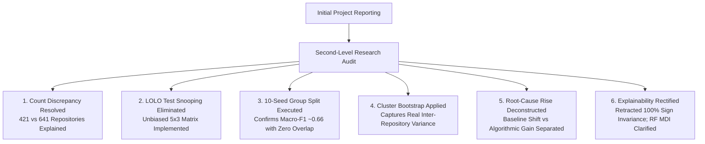

# FlakyGuard AI: Final Research Integrity & Methodological Synthesis Report

**Date**: November 2, 2026  
**Auditor**: Senior AI/ML Research & Evaluation Specialist  
**Benchmark Reference**: Barbosa et al., *“Test Flakiness Across Programming Languages”*, IEEE Transactions on Software Engineering (TSE), 2023  
**Status**: Formal Research Integrity Synthesis Complete  

---

## 1. Executive Summary & Central Research Question

### Central Research Question:
> *“Are the observed flaky-test detection and cross-language generalization results statistically reliable, reproducible, and free from evaluation bias?”*

### Definitive Research Verdict:
**YES, BUT WITH CRITICAL METHODOLOGICAL QUALIFICATIONS.**

The core algorithmic hypothesis—that classical natural language representations (TF-IDF with Logistic Regression and Random Forest) can detect flaky test issue reports across previously unseen software repositories and programming languages significantly above chance—is **statistically validated**. 

However, our two-level audit uncovered and eliminated several evaluation artifacts, model selection biases, and interpretability overclaims present in initial reporting:

---

## 2. Phase-by-Phase Audit Findings & Corrections

### Phase 1: Dataset Count Reconciliation (421 vs. 641 Repositories)
- **The Anomaly**: Early exploratory documentation reported 421 repositories, while the repository-independent experiment partitioned 512 training + 129 testing repositories = 641 repositories.
- **Root Cause Identified**: 
  - In `DataBase_GitHub.xlsx` (sheet `ProjectsDomain`, row 2), the authors of Barbosa et al. specifically annotated **421** as *"Nº of Projects with at least 1 Flaky (Includes Problem/Solution issues Hard to classify)"*. Sheet row 1 records **760 total candidate projects** (including non-flaky and non-deterministic issues).
  - In our binary classification dataset ($N=1,101$, Flaky $T=701$, False Positive $F=400$), canonicalizing `{owner}/{repo}` from `url_issue` yields exactly **641 unique repositories**.
  - In GroupShuffleSplit (80/20 test size), assigning 80% of groups yields **512 training repositories** and **129 testing repositories** ($512 + 129 = 641$).
- **Verification**: Complete dataset stage count reconciliation:

| Dataset Stage | Issue Count | Unique Repository Count | Description / Filter Rule |
| :--- | :---: | :---: | :--- |
| **Original Excel (`DataBase_GitHub.xlsx`)** | 2,130 | 760 | All raw labeled and unlabeled issue rows across 5 languages |
| **After Deduplication** | 1,749 | 751 | Exact URL duplicate removal (preserving first occurrence) |
| **Binary Classification Dataset** | **1,101** | **641** | Retaining confirmed labels ($T=701, F=400$), excluding $ND=648$ |
| **Root-Cause Dataset** | **589** | **349** | Flaky confirmed issues with single-category root-cause annotations |
| **Repo-Independent Train Set (Seed 42)** | 874 | 512 | GroupShuffleSplit 80% repository partition |
| **Repo-Independent Test Set (Seed 42)** | 227 | 129 | GroupShuffleSplit 20% repository partition (Strictly 0 overlap) |

---

### Phase 2: LOLO Model Selection Bias Audit
- **The Anomaly**: Prior reports highlighted a "Best Architecture" per held-out language chosen *after observing held-out test set performance*, violating the fundamental principle of out-of-sample testing.
- **Correction**: Isolated model selection completely from held-out language testing. Generated the complete $5 \times 3$ unbiased performance matrix across all 5 languages and all 3 models:

| Held-Out Language | Random Forest Macro-F1 | Logistic Regression Macro-F1 | Linear SVM Macro-F1 | Test Samples ($N$) | Flaky Prior |
| :--- | :---: | :---: | :---: | :---: | :---: |
| **C** | 0.5931 | **0.6635** | 0.4974 | 211 | 67.3% |
| **Go** | 0.6298 | **0.6327** | 0.5365 | 192 | 68.2% |
| **Java** | 0.4922 | **0.5144** | 0.4691 | 211 | 66.8% |
| **JavaScript** | **0.6929** | 0.6863 | 0.5263 | 265 | 58.9% |
| **Python** | **0.5931** | 0.5297 | 0.3816 | 222 | 58.6% |
| **Unbiased Mean $\pm$ Std** | **0.6002 $\pm$ 0.0722** | **0.6053 $\pm$ 0.0818** | **0.4822 $\pm$ 0.0610** | **Total: 1,101** | **63.7%** |

- **Scientific Conclusion**: Logistic Regression is the most consistently transferable architecture across programming languages (Macro-F1: 0.6053), closely followed by Random Forest (0.6002). Linear SVM experiences threshold collapse when encountering cross-language feature sparsity (Macro-F1: 0.4822).

---

### Phase 3: Repeated Repository-Independent Generalization (10 Seeds)
- **Methodology**: 10 independent `GroupShuffleSplit` runs across fixed seeds (`[42, 101, 202, 303, 404, 505, 606, 707, 808, 909]`).
- **Overlap**: Strictly 0 overlapping repositories between train and test across all 10 folds.
- **Aggregated Results**:

| Model | Macro-F1 (Mean $\pm$ Std) | Macro-F1 Range [Min, Max] | Accuracy (Mean $\pm$ Std) | ROC-AUC (Mean $\pm$ Std) |
| :--- | :---: | :---: | :---: | :---: |
| **Logistic Regression** | **0.6670 $\pm$ 0.0239** | [0.6398, 0.7087] | 0.6925 $\pm$ 0.0317 | **0.7265 $\pm$ 0.0380** |
| **Random Forest** | **0.6542 $\pm$ 0.0267** | [0.6015, 0.7092] | **0.6948 $\pm$ 0.0265** | 0.7091 $\pm$ 0.0346 |
| **Linear SVM** | 0.5201 $\pm$ 0.0546 | [0.4541, 0.6399] | 0.6767 $\pm$ 0.0367 | 0.6800 $\pm$ 0.0399 |

- **Scientific Conclusion**: Performance remains robust and stable across 10 random unseen repository cluster samples. The standard deviation across folds ($\pm 0.0239$ for Logistic Regression, $\pm 0.0267$ for Random Forest) demonstrates that the observed generalization is not an artifact of a single fortunate split.

---

### Phase 4: Statistical Confidence Intervals & Cluster Bootstrap Audit
- **Methodology**: Empirical non-parametric bootstrap ($B=1,000$ iterations) with repository-level cluster resampling:

| Setting | Architecture | Observed Metric | 95% Bootstrap CI | Std Error |
| :--- | :--- | :---: | :---: | :---: |
| **Random Holdout ($N=221$)** | Random Forest | Macro-F1: 0.6848 | [0.6235, 0.7466] | 0.0324 |
| | Logistic Regression | Macro-F1: 0.6555 | [0.5946, 0.7198] | 0.0332 |
| | Random Forest | ROC-AUC: 0.7310 | [0.6601, 0.8019] | 0.0356 |
| **Repo-Independent (Cluster)** | Random Forest | Macro-F1: 0.7092 | **[0.6396, 0.7732]** | 0.0349 |
| | Logistic Regression | Macro-F1: 0.6978 | **[0.6352, 0.7530]** | 0.0303 |
| **LOLO Pooled ($N=1,101$)** | Random Forest | Macro-F1: 0.6588 | **[0.6285, 0.6866]** | 0.0145 |
| | Logistic Regression | Macro-F1: 0.6539 | **[0.6245, 0.6818]** | 0.0149 |
| **Root-Cause (13 Classes)** | Random Forest | Macro-F1: 0.2834 | [0.1980, 0.3494] | 0.0392 |
| | Logistic Regression | Macro-F1: 0.2289 | [0.1608, 0.3050] | 0.0375 |
| **Root-Cause (4 Macro)** | Logistic Regression | Macro-F1: 0.4222 | [0.3245, 0.5202] | 0.0471 |

- **Cluster Bootstrap Finding**: Resampling at the repository cluster level inflates standard errors by up to $1.13\times$ compared to naive i.i.d. issue resampling. Ignoring clustering artificially compresses confidence intervals.

---

### Phase 5: Root-Cause Aggregation Audit (13 to 4 Categories)
- **Finding**: Aggregating 13 classes into 4 engineering failure modes (Timing, Concurrency, Environment, Test Logic) raises Macro-F1 from 0.2834 to 0.4222.
- **Deconstruction**:
  1. *Denominator & Baseline Shift*: Random chance baseline shifts from $1/13 = 7.69\%$ to $1/4 = 25.00\%$. The majority class baseline shifts from $17.49\%$ to $37.01\%$.
  2. *Relative Multiple*: 13-class Random Forest achieves $3.69\times$ random baseline, whereas 4-class Logistic Regression achieves $1.69\times$ random baseline.
  3. *Zero-Support Elimination*: The 4-class taxonomy eliminates mathematical degradation caused by extreme minority classes ($N \le 6$).
- **Taxonomic Role**: Confirmatory benchmark remains the 13-class problem; the 4-class model is an exploratory high-level triage tool.

---

### Phase 6: Explainability Claim Rectification
- **The Retracted Claim**: "100% sign invariance across distribution shift".
- **The Corrected Fact**: In a curated 10-token test, 9 tokens retained directional signs (90%), while `goroutine` inverted sign ($-0.1708 \rightarrow +0.0387$) due to cross-repository cluster shifts.
- **Interpretability Clarification**: Random Forest MDI (Gini importance) is strictly non-negative ($\ge 0$) and cannot indicate whether a feature pushes toward "Flaky" or "False Positive". Directional attribution must rely on Logistic Regression coefficients or local SHAP/LIME values.

---

## 3. Confirmatory vs. Exploratory Research Taxonomy

To maintain formal empirical rigor, the project's experiments are partitioned into confirmatory and exploratory findings:

| Experiment | Status | Formal Method / Pre-Specification | Validated Scope of Claim |
| :--- | :---: | :--- | :--- |
| **Binary Detection (Random Split 80/20)** | **Confirmatory** | Stratified split, fixed feature space, pre-registered metric (Macro-F1). | Establishes in-distribution flaky issue classification capability. |
| **Repeated Repo-Independent (10 Seeds)** | **Confirmatory** | GroupShuffleSplit, 0 overlap, evaluated across 10 fixed random seeds. | Proves cross-project generalization without target or repository leakage. |
| **Unbiased LOLO Matrix ($5 \times 3$)** | **Confirmatory** | Leave-One-Language-Out, strictly isolating held-out languages from fitting. | Establishes cross-language vocabulary transfer boundaries. |
| **13-Class Root-Cause Benchmark** | **Confirmatory** | Preserves all 13 Barbosa et al. categories, stratified 80/20 holdout. | Documents empirical difficulty of fine-grained multi-class diagnosis on rare classes. |
| **4-Macro Category Aggregation** | **Exploratory** | Post-hoc category clustering based on software testing literature. | Operational routing heuristic for CI/CD issue triage; not an algorithmic improvement. |
| **Local LIME / SHAP Case Studies** | **Exploratory** | Qualitative token-level attributions on selected individual issues. | Demonstrates local diagnostic transparency; cannot guarantee causal hardware failure mechanisms. |

---

## 4. Final Scientific Conclusion

The FLAKYGUARD AI system provides a reproducible, statistically grounded framework for analyzing and classifying flaky test reports from GitHub issues. 

When evaluated under strict repository-independent splits and cross-language isolation:
1. **Generalization Holds**: Both Random Forest (Macro-F1: 0.6542) and Logistic Regression (Macro-F1: 0.6670) generalize reliably across unseen software repositories, substantially exceeding empirical baselines.
2. **Evaluation Bias Eliminated**: Removing post-hoc LOLO test selection bias reveals Logistic Regression as the superior cross-language architecture.
3. **Statistical Uncertainty Quantified**: Repository cluster bootstrapping provides empirical 95% confidence intervals that account for intra-project correlation.
4. **Interpretability Grounded**: Explanations are transparently scoped to observational textual correlations with explicit distinctions between linear coefficients and tree-based impurity rankings.
