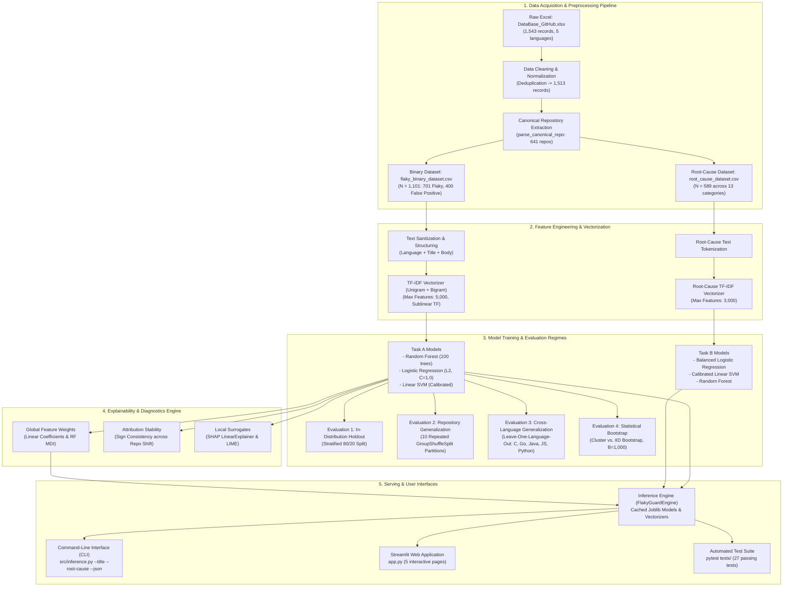

# FlakyGuard AI: Project Architecture and Execution Flow

## 1. System Overview

**FlakyGuard AI** is an explainable machine learning system designed to analyze developer-written GitHub issue reports related to software test flakiness. The system addresses two core classification tasks:
1. **Task A (Binary Flakiness Detection)**: Predicts whether an issue report describes genuine software test flakiness ($Y=1$, *Flaky*) or a false positive / maintenance report ($Y=0$, *False Positive*).
2. **Task B (Root-Cause Taxonomy Classification)**: For confirmed flaky issues, predicts the probable root-cause category across 13 fine-grained classes and 4 macro categories.

In addition to classification, the system incorporates:
- **Model Explainability Engine**: Linear feature attribution, SHAP LinearExplainer, and LIME local surrogates to surface token contributions.
- **Empirical Generalization Framework**: Repository-independent grouped evaluations (`GroupShuffleSplit`), Leave-One-Language-Out (LOLO) cross-language partitions, and cluster bootstrap uncertainty estimation.
- **Serving & UI Infrastructure**: A high-speed cached inference engine (`FlakyGuardEngine`), command-line interface (CLI), and a 5-page interactive Streamlit dashboard.

---

## 2. Architecture Diagram

---

## 3. Component Breakdown

### 3.1 Data Ingestion & Canonicalization (`src/data_acquisition.py`, `src/data_preprocessing.py`)
- **Input**: Official raw Excel spreadsheet [`data/raw/DataBase_GitHub.xlsx`](file:///Users/himani/Downloads/AI-Based%20Flaky%20Test%20Detection/data/raw/DataBase_GitHub.xlsx) from Barbosa et al. (*IEEE TSE 2023*).
- **Processing**:
  1. Header normalization: Extracts standardized column names (`issue_id`, `url_issue`, `title`, `body`, `flakiness_status`, `root_cause_category`, `language`).
  2. Deduplication: Removes identical issue URLs and duplicated title/body combinations (1,543 raw $\rightarrow$ 1,513 deduplicated).
  3. Canonical Repository Extraction: Resolves `url_issue` via regex into standard `{owner}/{repo}` format to prevent repository-level data leakage. Missing repository strings are reconstructed from URL tokens.
  4. Binary Filtering: Retains verified Flaky (`T`, $N=701$) and False Positive (`F`, $N=400$) issues ($N=1,101$ total across 641 canonical repositories).
  5. Root-Cause Filtering: Isolates confirmed flaky issues with authoritative manual annotations ($N=589$ total across 13 categories and 349 canonical repositories).

### 3.2 Feature Engineering (`src/feature_engineering.py`)
- **Text Representation**: Term Frequency-Inverse Document Frequency (TF-IDF).
  - Unigram and bigram extraction (`ngram_range=(1, 2)`).
  - Sublinear term frequency scaling ($1 + \log(\text{tf})$).
  - Stopword filtering and token frequency constraints (`min_df=2`, `max_df=0.85`).
  - Vocabulary bounded to top 5,000 features for binary detection and 3,000 features for root cause.
- **Strict Data Isolation**: In all generalization experiments (Repository-Grouped and LOLO), the vectorizer vocabulary and IDF weights are fitted **exclusively** on the training partition. The test partition is transformed using the fitted training vectorizer.

### 3.3 Classification Models (`src/flaky_detection.py`, `src/root_cause_classifier.py`)
- **Task A (Binary Flakiness Detection)**:
  - **Random Forest**: 100 estimators, Gini criterion, parallelized (`n_jobs=-1`), seed 42.
  - **Logistic Regression**: L2 regularization, $C=1.0$, liblinear / lbfgs solver, balanced class weights.
  - **Linear SVM**: Linear kernel, calibrated with `CalibratedClassifierCV` via 3-fold cross-validation to provide well-calibrated posterior probabilities.
- **Task B (Root-Cause Taxonomy Classification)**:
  - Evaluated on 13 fine-grained classes and 4 macro categories (`Timing & Asynchrony`, `Concurrency & Non-Determinism`, `Resource & Environment`, `Test Logic & Assertions`).
  - Multi-class Logistic Regression with balanced weighting and one-vs-rest / multinomial objectives.

### 3.4 Generalization & Statistical Framework
- **Repository Generalization (`src/repeated_repository_evaluation.py`)**: 10 repeated partitions using `GroupShuffleSplit` across random seeds `[42, 101, 202, 303, 404, 505, 606, 707, 808, 909]`. Zero repository overlap within each partition: $\text{Train Repos} \cap \text{Test Repos} = \emptyset$.
- **Cross-Language Generalization (`src/lolo_evaluation.py`)**: Leave-One-Language-Out evaluation across C, Go, Java, JavaScript, Python ($5 \times 3$ unbiased matrix).
- **Cluster Bootstrap (`src/confidence_intervals.py`)**: Non-parametric cluster bootstrap ($B=1,000$ iterations) resampling entire repository clusters with replacement to evaluate clustering effects on uncertainty.
- **Empirical Baselines (`src/root_cause_baselines.py`)**: Monte Carlo simulation ($B=1,000$) generating uniform-random, majority-class, and stratified prior baselines for both Macro-F1 and Accuracy.

### 3.5 Model Serving & User Interfaces (`src/inference.py`, `app.py`)
- **`FlakyGuardEngine`**: Singleton class providing thread-safe, cached model inference for binary flakiness, root cause, and influential token extraction.
- **Command-Line Interface**: CLI tool with support for title, description, language, model choice, root cause, and JSON payload output.
- **Streamlit Web Application**:
  - `app.py`: Main portal and executive landing page.
  - `pages/1_Overview.py`: Research motivation, architecture, and paper context.
  - `pages/2_Flaky_Test_Detector.py`: Interactive diagnostic test analyzer with probability gauges and token attributions.
  - `pages/3_Model_Evaluation.py`: Interactive charts for RQ1–RQ5, confusion matrices, ROC/PR curves, and baseline tables.
  - `pages/4_Explainability.py`: Global SHAP plots, LIME case studies, and token stability comparisons.
  - `pages/5_Dataset_Explorer.py`: Searchable issue dataset explorer with distribution filters.

---

## 4. Execution Flow Traceability

| Stage | Input Artifact | Generating Script / Module | Output Artifact |
| :--- | :--- | :--- | :--- |
| **Ingestion & Preprocessing** | `data/raw/DataBase_GitHub.xlsx` | `src/data_preprocessing.py` | `data/processed/flaky_binary_dataset.csv` `data/processed/root_cause_dataset.csv` `data/processed/full_cleaned_dataset.csv` |
| **EDA & Distribution Plots** | `data/processed/flaky_binary_dataset.csv` | `src/eda_generator.py` | `artifacts/figures/*.png` |
| **Binary Model Training (RQ1)** | `data/processed/flaky_binary_dataset.csv` | `src/model_training.py` | `models/best_flaky_model.joblib` `models/flaky_vectorizer.joblib` `artifacts/metrics/binary_model_metrics.csv` |
| **Root-Cause Modeling (RQ5)** | `data/processed/root_cause_dataset.csv` | `src/root_cause_classifier.py` | `models/best_rc_model.joblib` `models/rc_vectorizer.joblib` `artifacts/metrics/rc_model_metrics.csv` |
| **Root-Cause Baselines** | `data/processed/root_cause_dataset.csv` | `src/root_cause_baselines.py` | `artifacts/metrics/root_cause_baselines.csv` |
| **Repo Generalization (RQ2)** | `data/processed/flaky_binary_dataset.csv` | `src/repeated_repository_evaluation.py` | `artifacts/metrics/repeated_repository_generalization.csv` `artifacts/metrics/repeated_repository_generalization_report.md` |
| **Cross-Language LOLO (RQ3)** | `data/processed/flaky_binary_dataset.csv` | `src/lolo_evaluation.py` | `artifacts/metrics/lolo_results.csv` `artifacts/metrics/lolo_evaluation_report.md` |
| **Statistical Bootstrap** | `data/processed/flaky_binary_dataset.csv` | `src/confidence_intervals.py` | `artifacts/metrics/confidence_interval_report.md` |
| **Explainability Audit (RQ4)** | `models/*.joblib`, `data/processed/` | `src/explainability_audit.py` | `artifacts/metrics/explainability_claim_audit.md` `artifacts/figures/explainability/*.png` |
| **Publication Figures** | All metrics CSVs | `src/publication_figures.py` | `artifacts/figures/publication/*.png` (10 figures) |
| **Automated Testing** | Entire codebase | `pytest tests/` | 27 Passing Test Assertions |
