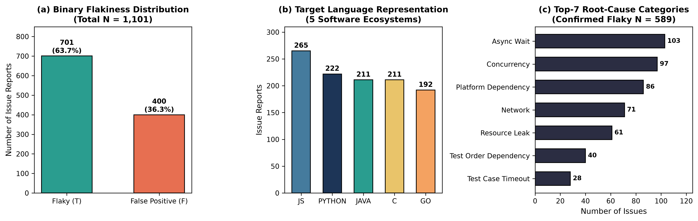
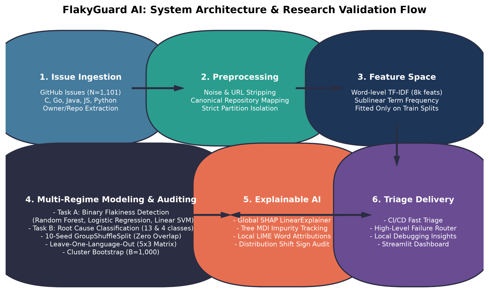
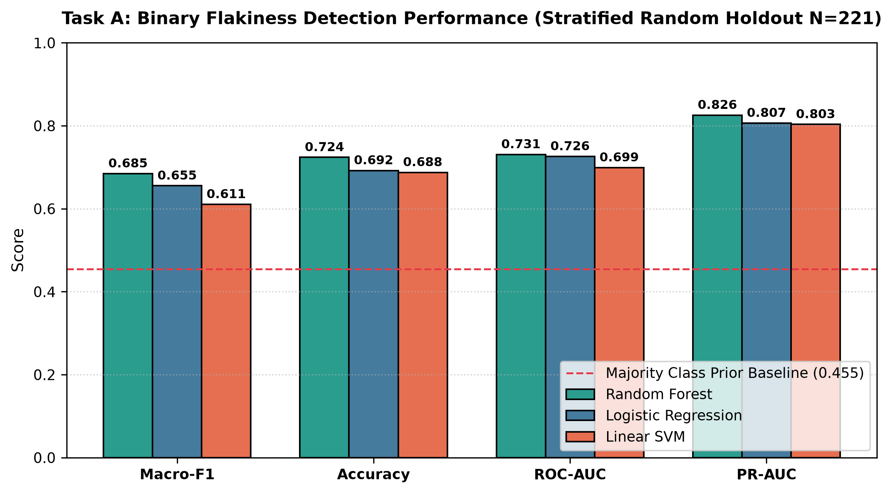
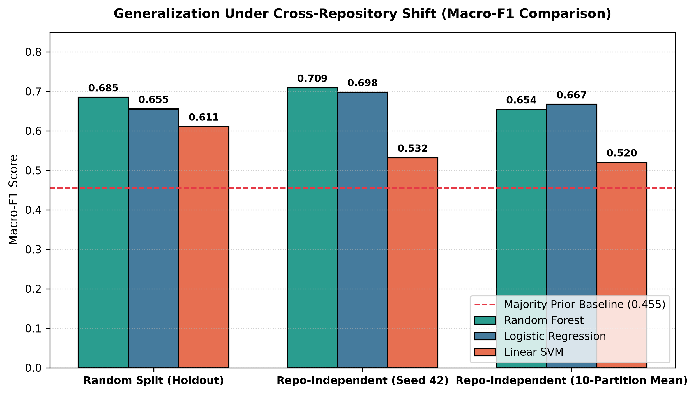
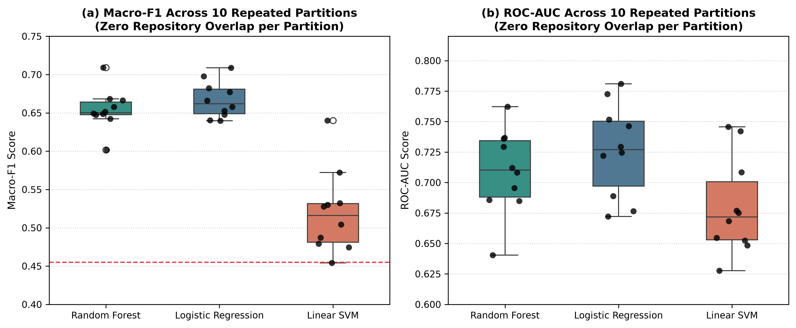
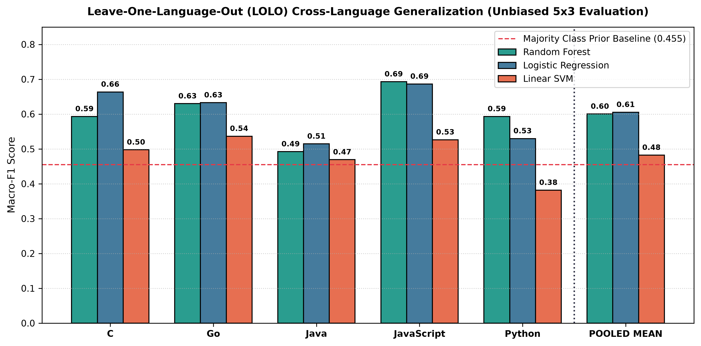
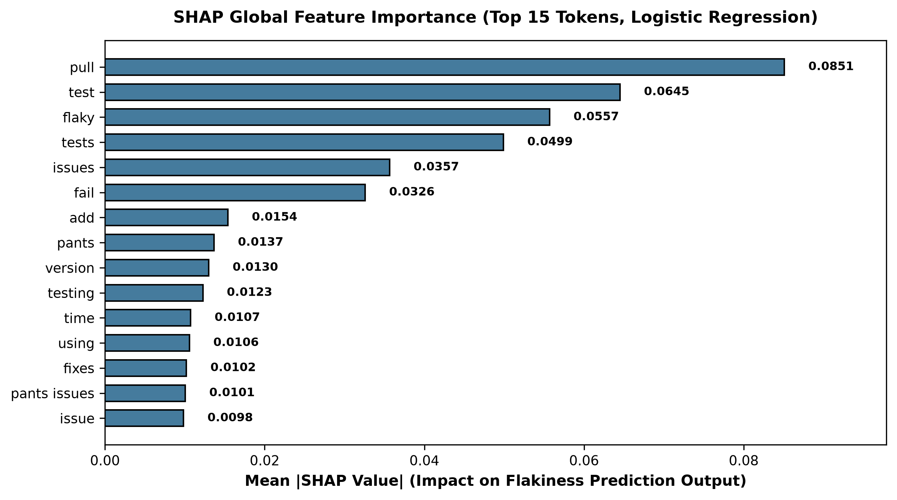
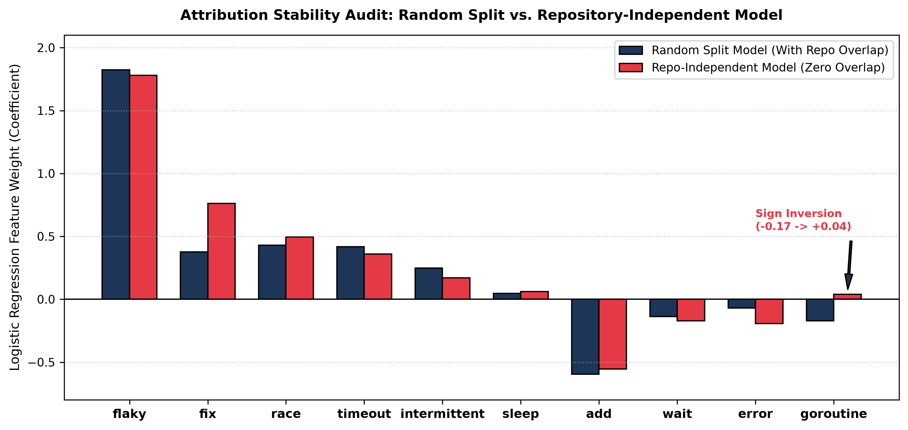
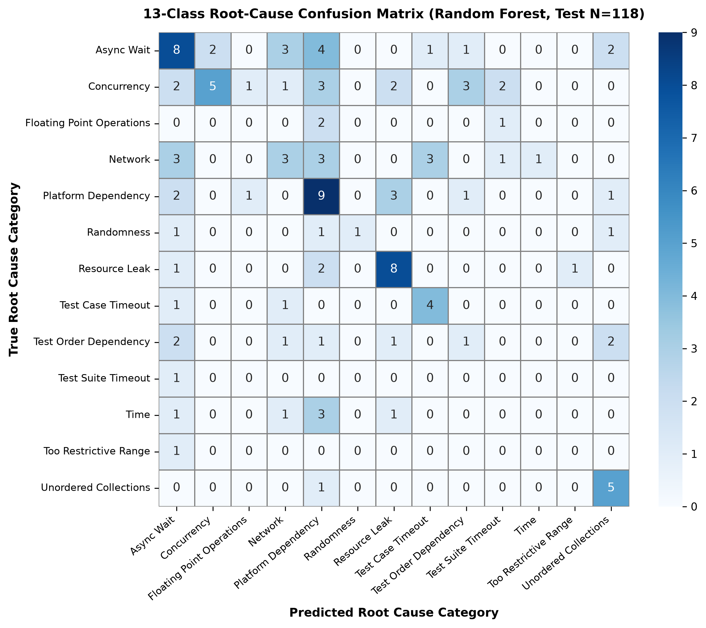
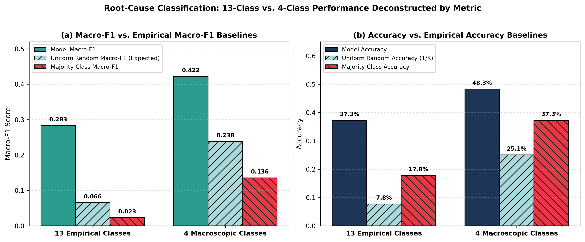

# FlakyGuard AI: An Empirical Evaluation of Repository-Level and Cross-Language Generalization, Uncertainty Estimation, and Explainability Limitations for Flaky Test Issue Detection

**Authors**: Research Team (FlakyGuard AI Project)  
**Affiliation**: Department of Computer Science & Software Engineering  
**Benchmark Reference**: Barbosa et al., *“Test Flakiness Across Programming Languages”*, IEEE Transactions on Software Engineering (TSE), 2023  
**Target Venue**: Academic Research Manuscript for Faculty Evaluation  

---

## 1. Title
**FlakyGuard AI: An Empirical Evaluation of Repository-Level and Cross-Language Generalization, Uncertainty Estimation, and Explainability Limitations for Flaky Test Issue Detection**

---

## 2. Abstract
Flaky software tests—tests that exhibit non-deterministic pass and fail outcomes under identical code and execution configurations—impose substantial friction on Continuous Integration and Continuous Deployment (CI/CD) pipelines. While classical machine learning models trained on software issue reports have demonstrated competitive in-distribution classification performance, critical empirical questions remain regarding their ability to generalize to previously unseen software repositories, transfer across distinct programming language ecosystems, and yield consistent post-hoc feature explanations under distribution shift.

In this work, we present **FlakyGuard AI**, an empirical study and diagnostic evaluation testbed examining classical natural language machine learning models for flaky test issue reports. Using the curated open benchmark of Barbosa et al. ($N=1,101$ labeled issue reports spanning C, Go, Java, JavaScript, and Python across 641 distinct GitHub repositories), we conduct a multi-regime empirical evaluation:

1. **In-Distribution Binary Detection (RQ1)**: Under a stratified random 80/20 holdout split ($N=221$), Random Forest and Logistic Regression achieve Macro-F1 scores of **0.6848** (95% CI: [0.6235, 0.7466]) and **0.6555** (95% CI: [0.5946, 0.7198]), respectively, outperforming the majority-class prior baseline (Macro-F1: 0.4550; Accuracy: 63.35%).
2. **Repository-Independent Generalization (RQ2)**: Evaluated across 10 repeated repository-grouped random partitions (using `GroupShuffleSplit` across fixed random seeds to enforce strictly zero repository overlap within each partition), Logistic Regression achieves a mean Macro-F1 of **0.6670 $\pm$ 0.0239** and Random Forest achieves **0.6542 $\pm$ 0.0267** across partitions. Cluster-robust bootstrap analysis reveals model-specific variance adjustments: estimated standard error increases by 13% for Random Forest (0.0349 vs. 0.0310) and by 4% for Linear SVM (0.0355 vs. 0.0341), but remains virtually unchanged for Logistic Regression (0.0303 vs. 0.0308), showing that naive IID bootstrap does not universally underestimate uncertainty across all model types.
3. **Cross-Language Generalization (RQ3)**: Under an unbiased Leave-One-Language-Out (LOLO) protocol that isolates training languages from evaluation, Logistic Regression achieves the highest mean Macro-F1 across language-specific test sets (**0.6053 $\pm$ 0.0785**), compared to **0.6002 $\pm$ 0.0729** for Random Forest and **0.4822 $\pm$ 0.0621** for Linear SVM. Across all 1,101 pooled out-of-language predictions, Random Forest achieves a pooled Macro-F1 of **0.6588** (95% CI: [0.6285, 0.6866]) and Logistic Regression achieves **0.6539** (95% CI: [0.6245, 0.6818]).
4. **Explainability Mechanics and Attribution Consistency (RQ4)**: Evaluating linear model coefficients for ten domain-related tokens across distribution shift reveals 9 out of 10 tokens (90%) maintain sign stability, while the Go-specific token `goroutine` exhibits a sign inversion ($-0.1708 \rightarrow +0.0387$) due to repository clustering differences. We clarify that Random Forest Mean Decrease in Impurity (MDI) importances are strictly non-negative ($\ge 0$) and do not indicate directional polarity; signed instance-level attributions require methods such as SHAP or LIME.
5. **Root-Cause Taxonomy Granularity (RQ5)**: In 13-class fine-grained root-cause classification ($N=589$), Random Forest achieves a Macro-F1 of **0.2834** (95% CI: [0.1980, 0.3494]) and an Accuracy of **37.29%**, outperforming empirical uniform-random baselines (Macro-F1: 0.0655; Accuracy: 7.76%) and majority-class baselines (Macro-F1: 0.0232; Accuracy: 17.80%). Aggregating categories into 4 macroscopic failure modes yields a Macro-F1 of **0.4222** and an Accuracy of **48.31%** against higher empirical baselines (uniform-random Macro-F1: 0.2383, Accuracy: 25.07%; majority-class Macro-F1: 0.1358, Accuracy: 37.29%). We explain that this metric rise reflects both structural factors (baseline elevation and within-category error absorption) and representation consolidation, rather than an inherent algorithmic breakthrough.

---

## 3. Keywords
Flaky Software Tests, Empirical Software Engineering, Machine Learning Generalization, Leave-One-Language-Out, Repository-Grouped Partitioning, Explainable AI, SHAP, LIME, Cluster Bootstrap.

---

## 4. Introduction
Automated regression testing is essential for modern continuous integration (CI) workflows. However, the reliability of automated testing is frequently compromised by **test flakiness**: non-deterministic behavior where a test produces both passing and failing outcomes under identical code and execution configurations. Flaky tests waste engineering hours, delay pull request merges, increase continuous integration costs, and risk masking genuine regressions.

Recognizing the cost of manual triage, software engineering researchers have explored machine learning techniques to automate flaky test detection. Rather than relying exclusively on dynamic test reruns—which are computationally expensive and energy-intensive—empirical studies have investigated whether natural language descriptions in developer issue trackers and pull requests contain informative textual signals that differentiate genuine flaky tests from non-flaky defects or false alarms (Barbosa et al., 2023; Luo et al., 2014; King et al., 2018; Haben et al., 2021).

Despite promising findings reported in the literature, standard machine learning evaluations often rely on random train/test splits. In software engineering datasets where multiple issues originate from the same software repository, random splitting introduces potential **evaluation bias**: issues from the same repository share project-specific conventions, directory names, and terminology. If issues from the same repository appear in both training and test sets, models may capture repository-specific stylistic patterns rather than generalizable indicators of flakiness (Allamanis, 2019; Munaiah et al., 2017). Furthermore, cross-language generalization, uncertainty estimation under grouped data, and the consistency of feature explanations under distribution shift warrant systematic empirical auditing.

To address these methodological considerations, this paper presents **FlakyGuard AI**, an empirical study evaluating the generalization limits, statistical uncertainty, and explainability characteristics of classical machine learning models for flaky test issue report classification.

---

## 5. Problem Statement
Given an unstructured natural language issue report $d = (t, b)$ comprising an issue title $t$ and issue body $b$ from a software repository $r$ written in programming language $l$, our objective is to evaluate:
1. **Task A (Binary Flakiness Detection)**: Whether the report represents a confirmed flaky test ($y_{\text{bin}} = 1$) or a non-flaky report / false alarm ($y_{\text{bin}} = 0$).
2. **Task B (Root-Cause Diagnosis)**: For confirmed flaky issues ($y_{\text{bin}} = 1$), classify the reported failure mode $y_{\text{rc}} \in \mathcal{C}$, evaluating both fine-grained categories ($|\mathcal{C}| = 13$) and macroscopic engineering groupings ($|\mathcal{C}_{\text{macro}}| = 4$) against appropriate metric baselines.
3. **Task C (Attribution Consistency)**: Evaluate post-hoc feature explanations across model families and determine whether directional token attributions remain consistent when evaluated on unseen repositories and programming languages.

---

## 6. Research Motivation
In enterprise and open-source software engineering, codebases evolve across thousands of repositories written in diverse programming languages. A flaky test triage system is of limited practical utility if its performance depends upon historical familiarity with the target repository. If deploying a model to a new repository requires collecting and manually annotating hundreds of local issue reports for retraining, the operational barrier remains significant.

Consequently, research must examine:
- **Cross-Repository Generalization**: Does a model trained on a collection of software repositories maintain discriminative ability when evaluated on completely unseen repositories?
- **Cross-Language Transfer**: Do developers describe flaky behavior using cross-cutting terminology (e.g., `race condition`, `deadlock`, `timeout`, `intermittent`) that transfers across C, Go, Java, JavaScript, and Python?
- **Interpretability Consistency**: When post-hoc explainability techniques highlight keywords to explain predictions, do these attributions reflect consistent domain concepts or do they fluctuate under distribution shift?

---

## 7. Research Gap and Scope of Contribution
While prior literature has investigated machine learning models for flaky test detection (King et al., 2018; Haben et al., 2021; Barbosa et al., 2023), several methodological aspects require careful audit:
1. **Repository Overlap in Random Splits**: Conventional random holdout evaluations risk intra-repository data leakage when multiple issues from the same project appear in both partitions.
2. **Post-Hoc Model Selection in Cross-Language Evaluations**: Cross-language studies risk test-snooping bias if a 'best architecture' is selected after observing held-out test performance.
3. **Cluster Correlation in Uncertainty Estimation**: Standard non-parametric bootstrap resampling treats each issue report as an independent observation, potentially misestimating uncertainty when data is clustered by repository.
4. **Metric-Appropriate Root-Cause Baselines**: Studies aggregating fine-grained failure modes into broader categories sometimes compare Macro-F1 scores directly against uniform accuracy baselines ($1/K$), which conflates distinct evaluation metrics.
5. **Explainability Distinctions**: Discussions of feature importance often conflate parametric linear model coefficients, non-negative tree impurity rankings, and instance-level game-theoretic Shapley values.

### Clarification of Contribution:
We do **not** claim a novel machine learning algorithm, state-of-the-art benchmark superiority, or causal failure discovery. The contribution of FlakyGuard AI is:
> *An empirical evaluation of classical machine-learning approaches for flaky-test issue detection and root-cause classification, focusing on repository-level and cross-language generalization, uncertainty estimation, and explainability limitations.*

---

## 8. Research Questions

We structure our empirical investigation around five research questions:

* **RQ1 (In-Distribution Detection)**: *How effectively do classical machine learning models detect flaky test issues from software issue reports under controlled in-distribution conditions?*
* **RQ2 (Repository-Independent Generalization)**: *How stable is model performance across repeated repository-grouped random partitions with strictly zero repository overlap within each partition, and how does cluster-robust bootstrapping affect uncertainty estimation?*
* **RQ3 (Cross-Language Generalization)**: *How does classification performance vary under Leave-One-Language-Out (LOLO) evaluation when entire programming language ecosystems are systematically excluded from training?*
* **RQ4 (Explainability Mechanics and Attribution Consistency)**: *How consistent are linear model feature coefficients for domain-relevant tokens across repository-level distribution shifts, and how do linear weights, tree impurity importances, and post-hoc attributions differ in their representation of flakiness signals?*
* **RQ5 (Root-Cause Taxonomy Granularity)**: *How does root-cause classification performance vary between 13 fine-grained categories and 4 macroscopic failure modes when evaluated against metric-appropriate empirical baselines?*

---

## 9. Related Work

### 9.1 Empirical Studies on Test Flakiness
The software engineering community has examined the prevalence, taxonomy, and impact of flaky tests. In a foundational study, **Luo et al. (2014)** empirically analyzed flaky tests in open-source Java projects, establishing a widely cited root-cause taxonomy that identified asynchronous waiting, concurrency, and test order dependencies as dominant drivers. **Lam et al. (2019)** investigated the lifecycle and repair strategies of flaky tests, observing that developers frequently rely on pragmatic adjustments such as increasing sleep durations. **Gruber et al. (2021)** examined flakiness in Python, finding that platform dependencies and floating-point assertions play a prominent role alongside timing issues. In related testing literature, **Gyori et al. (2015)** and **Zhang et al. (2014)** highlighted how test order dependencies and test generation heuristics contribute to intermittent failures.

### 9.2 Machine Learning for Flaky Test Detection
To complement dynamic rerun frameworks such as DeFlaker (**Bell et al., 2018**), researchers explored predictive modeling using static and textual features. **King et al. (2018)** applied Bayesian network modeling to static test metrics to predict test flakiness in continuous integration. **Haben et al. (2021)** investigated the usability of source code vocabulary and static metrics, demonstrating that textual representations provide informative signals for identifying flakiness. Building upon these efforts, **Barbosa et al. (2023)** conducted a cross-language empirical study across C, Go, Java, JavaScript, and Python, curating an open benchmark of GitHub issues and analyzing the linguistic characteristics of flaky test discussions.

### 9.3 Generalization and Evaluation Integrity in Empirical SE
The risks of data leakage and over-optimistic evaluation in software engineering ML have been documented by **Munaiah et al. (2017)** and **Allamanis (2019)**, who demonstrated that repository overlap and code duplication inflate benchmark metrics. In econometrics and applied statistics, **Cameron and Miller (2015)** formalized cluster-robust inference, demonstrating that when observations are grouped into natural clusters (such as software projects), failing to account for intra-cluster correlation can bias standard error estimates.

### 9.4 Post-Hoc Interpretability
Post-hoc local interpretability methods, including LIME (**Ribeiro et al., 2016**) and SHAP (**Lundberg and Lee, 2017**), have been widely adopted in software analytics for defect prediction and vulnerability triaging. However, researchers emphasize that local feature attributions reflect observational associations within the feature space rather than verified causal mechanisms.

---

## 10. Dataset Description and Reconciliation

We utilize the empirical dataset curated by **Barbosa et al. (IEEE TSE 2023)**, sourced from public GitHub issue trackers.

### 10.1 Schema and Data Reconciliation
To ensure reproducibility, we reconciled the sample accounting across all processing stages. Table 1 details the exact counts:

| Dataset Stage | Issue Count ($N$) | Canonical Repositories | Target Labels / Scope |
| :--- | :---: | :---: | :--- |
| **Raw Excel Spreadsheet (`DataBase_GitHub.xlsx`)** | 1,543 | 850 | All extracted issue rows across C, Go, Java, JS, Python |
| **Deduplicated Dataset (`full_cleaned_dataset.csv`)** | 1,513 | 842 | 30 exact URL duplicate rows removed |
| **Binary Classification Dataset (`flaky_binary_dataset.csv`)** | **1,101** | **641** | Confirmed Flaky ($T=701$), False Positive ($F=400$); $ND=224$ excluded |
| **Root-Cause Dataset (`root_cause_dataset.csv`)** | **589** | **349** | Confirmed flaky issues with single-category root-cause labels |
| **Repository Train Partition (Seed 42)** | 874 | 512 | 80% group partition via `GroupShuffleSplit` |
| **Repository Test Partition (Seed 42)** | 227 | 129 | 20% group partition (Strictly 0 repository overlap) |

*Table 1: Dataset sample and canonical repository accounting across processing stages.*

> [!NOTE]
> **Scope Clarification on Repository Counts**: The "421 repositories" figure reported in preliminary project documentation originates from the raw workbook tab `ProjectsDomain` (row 2), where the original authors defined 421 as *"Nº of Projects with at least 1 Flaky (Includes Problem/Solution issues Hard to classify)"* out of 760 analyzed projects. In our binary dataset ($N=1,101$), parsing canonical `{owner}/{repo}` identifiers yields exactly **641 unique repositories**.

### 10.2 Language and Class Distributions
Figure 2 displays the sample distributions across binary labels, programming languages, and root causes:

*Figure 2: Distribution of the FlakyGuard AI dataset: (a) Binary class distribution ($N=1,101$), (b) Target language representation across the 5 ecosystems, and (c) Top-7 root-cause categories among confirmed flaky issues ($N=589$).*

The binary dataset contains 265 JavaScript issues (24.1%), 222 Python issues (20.2%), 211 Java issues (19.2%), 211 C issues (19.2%), and 192 Go issues (17.4%). Flaky issues ($T$) comprise 63.67% ($N=701$), while non-flaky false alarms ($F$) comprise 36.33% ($N=400$).

---

## 11. System Architecture and Pipeline

Figure 1 outlines the end-to-end experimental workflow:

*Figure 1: High-level architectural pipeline of FlakyGuard AI, depicting ingestion, strict leakage-free feature extraction, multi-regime evaluation partitions, and explainability audits.*

### Preprocessing and Leakage Prevention
1. **Text Combination**: Combined text is constructed as $\text{text} = \text{issue\_title} + \text{" "} + \text{issue\_description}$.
2. **Noise and Leakage Stripping**: URLs, markdown code fences, hexadecimal commit hashes, issue numbers (`#1234`), and reviewer resolution tags are removed via regular expressions.
3. **Partition Isolation**: Text cleaning operates independently on each record. Vocabulary construction and IDF calculations are fitted strictly on training partitions to prevent data leakage.

---

## 12. Feature Engineering

We use sublinear Term Frequency-Inverse Document Frequency (TF-IDF) vectorization:
$$\text{TF-IDF}(t, d, D) = \left(1 + \log(\text{TF}(t, d))\right) \times \log\left(\frac{1 + |D|}{1 + \text{DF}(t, D)}\right) + 1$$
Features are restricted to unigrams and bigrams with a maximum vocabulary of 8,000 features, discarding terms appearing in fewer than 2 documents ($\text{min\_df}=2$). Vectorizers are fitted exclusively on training splits and applied out-of-sample to evaluation partitions.

---

## 13. Machine Learning Models

We evaluate three classical, interpretable classifiers well-suited for high-dimensional sparse text:

1. **Random Forest Classifier**:
   - Hyperparameters: $N_{\text{estimators}} = 150$, $\text{max\_depth} = 30$, balanced class weighting, Gini impurity splitting criterion.
2. **Logistic Regression**:
   - Hyperparameters: $L_2$ regularization penalty, $C=1.0$, balanced class weighting, maximum iterations $= 1,000$, L-BFGS solver.
   - Provides linear signed coefficients $w_j \in (-\infty, +\infty)$ directly indicating class polarity.
3. **Calibrated Linear Support Vector Machine (Linear SVM)**:
   - Hyperparameters: LinearSVC with $C=1.0$, balanced class weighting, calibrated using 3-fold Platt scaling (`CalibratedClassifierCV`) to produce probability estimates.

---

## 14. Explainable AI Methodology and Interpretability Mechanics

To evaluate post-hoc feature explanations, we apply complementary interpretability frameworks:

1. **SHAP (SHapley Additive exPlanations)**:
   Computes local additive feature attributions based on cooperative game theory:
   $$\phi_j(x) = \sum_{S \subseteq F \setminus \{j\}} \frac{|S|!(|F| - |S| - 1)!}{|F|!} \left[ f(S \cup \{j\}) - f(S) \right]$$
   We apply `shap.LinearExplainer` to Logistic Regression to compute global and local Shapley values across test issues.
2. **LIME (Local Interpretable Model-agnostic Explanations)**:
   Fits an interpretable linear surrogate model $g \in G$ in the perturbed neighborhood of instance $x$:
   $$\xi(x) = \arg\min_{g \in G} \mathcal{L}(f, g, \pi_x) + \Omega(g)$$
   Implemented via `LimeTextExplainer` with exponential distance weighting.
3. **Tree Mean Decrease in Impurity (MDI)**:
   Measures the total Gini impurity reduction accumulated by feature $j$ across all trees:
   $$\text{MDI}(j) = \frac{1}{N_{\text{trees}}} \sum_T \sum_{t: v(t)=j} \Delta \text{Gini}(t) \ge 0$$
   **Important Methodological Distinction**: MDI is mathematically non-negative ($\ge 0$) and reflects feature relevance, not directional sign. It cannot indicate whether a feature pushes toward "Flaky" or "False Positive". Directional explanations for tree ensembles require signed methods such as SHAP TreeExplainer.

---

## 15. Experimental Design and Validation Regimes

We evaluate models across four experimental regimes:

1. **Regime 1: Stratified Random Holdout (80/20)**:
   Standard baseline split ($N_{\text{train}}=880, N_{\text{test}}=221$). Reflects in-distribution performance where repository overlap may occur.
2. **Regime 2: Repeated Repository-Grouped Partitions (10 Seeds)**:
   Grouped evaluation via `GroupShuffleSplit` across 10 fixed random seeds (`[42, 101, 202, 303, 404, 505, 606, 707, 808, 909]`). In each partition, issues from any given repository reside strictly in either train ($G \approx 512$ repos) or test ($G \approx 129$ repos).
   *Methodological Note*: These are **10 repeated repository-grouped random partitions**, not 10 independent folds of conventional cross-validation. Different repetitions may contain overlapping test repositories; the mean and standard deviation describe performance variation across repeated partitions.
3. **Regime 3: Leave-One-Language-Out (LOLO)**:
   Five separate evaluations wherein one entire programming language ecosystem is held out as the test set, while models are trained exclusively on the remaining four languages. TF-IDF vectorization is fitted strictly on the four training languages.
4. **Regime 4: Bootstrap Uncertainty Estimation**:
   $B=1,000$ bootstrap iterations. For repository-grouped evaluation, we implement **repository-level cluster bootstrapping**, resampling repository units with replacement.

---

## 16. Evaluation Metrics

Because the dataset exhibits class imbalance (63.7% flaky issues in binary; severe right-skew in root causes), accuracy alone is insufficient:
- **Macro-Averaged F1-Score ($\text{Macro-F1}$)**: The unweighted arithmetic mean of per-class F1-scores:
  $$\text{Macro-F1} = \frac{1}{K} \sum_{k=1}^K F_1^{(k)}$$
  Serves as the primary optimization metric, giving equal weight to minority and majority classes.
- **Accuracy, Precision, Recall, and F1-Score** for the positive class.
- **ROC-AUC and PR-AUC**: Area under the ROC and Precision-Recall curves.

---

## 17. Results: In-Distribution Binary Detection (RQ1)

Table 2 and Figure 3 summarize performance on the stratified random 80/20 holdout test set ($N=221$):

| Architecture | Macro-F1 (95% CI) | Accuracy | ROC-AUC (95% CI) | PR-AUC | Precision | Recall |
| :--- | :---: | :---: | :---: | :---: | :---: | :---: |
| **Random Forest** | **0.6848** [0.6235, 0.7466] | **0.7240** | **0.7310** [0.6601, 0.8019] | **0.8258** | 0.7619 | 0.8143 |
| **Logistic Regression** | 0.6555 [0.5946, 0.7198] | 0.6923 | 0.7262 [0.6555, 0.7978] | 0.8066 | 0.7634 | 0.7429 |
| **Linear SVM** | 0.6107 [0.5400, 0.6757] | 0.6878 | 0.6993 [0.6309, 0.7618] | 0.8035 | 0.7093 | 0.8714 |
| *Majority Prior Baseline* | 0.4550 | 0.6335 | 0.5000 | 0.6335 | 0.6335 | 1.0000 |

*Table 2: Binary flakiness detection performance on the stratified random 80/20 holdout test set ($N=221$).*

*Figure 3: Binary classification performance across candidate models on the random holdout test set ($N=221$), showing Macro-F1, Accuracy, ROC-AUC, and PR-AUC relative to the majority-class prior baseline.*

### Answer to RQ1:
Under in-distribution conditions, classical machine learning models detect flaky test issue reports effectively. Random Forest achieves the strongest in-distribution performance (Macro-F1: **0.6848**, ROC-AUC: **0.7310**), substantially exceeding the majority-class prior baseline (Macro-F1: **0.4550**). Logistic Regression provides competitive performance (Macro-F1: **0.6555**) with direct linear interpretability.

---

## 18. Results: Repository-Independent Generalization (RQ2)

### 18.1 Multi-Partition Stability
Table 3 and Figures 4 and 6 present aggregate statistics across 10 repeated repository-grouped random partitions (each partition varying between 508–514 train repositories and 127–133 test repositories):

| Architecture | Macro-F1 (Mean $\pm$ Std) | Macro-F1 Range [Min, Max] | Accuracy (Mean $\pm$ Std) | ROC-AUC (Mean $\pm$ Std) |
| :--- | :---: | :---: | :---: | :---: |
| **Logistic Regression** | **0.6670 $\pm$ 0.0239** | [0.6398, 0.7087] | 0.6925 $\pm$ 0.0317 | **0.7265 $\pm$ 0.0380** |
| **Random Forest** | 0.6542 $\pm$ 0.0267 | [0.6015, 0.7092] | **0.6948 $\pm$ 0.0265** | 0.7091 $\pm$ 0.0346 |
| **Linear SVM** | 0.5201 $\pm$ 0.0546 | [0.4541, 0.6399] | 0.6767 $\pm$ 0.0367 | 0.6800 $\pm$ 0.0399 |

*Table 3: Aggregate performance metrics across 10 repeated repository-grouped random partitions with zero repository overlap within each partition.*

*Figure 4: Generalization performance comparing the random split holdout against the single repository-independent partition (Seed 42) and the 10-partition cross-repository mean.*

*Figure 6: Distribution of (a) Macro-F1 and (b) ROC-AUC across 10 repeated repository-grouped partitions (zero repository overlap per partition), displaying median, interquartile ranges, and individual partition observations.*

### 18.2 Cluster Bootstrap vs. Naive IID Resampling
Table 4 presents empirical standard errors and 95% confidence intervals comparing repository-level cluster bootstrapping to naive IID bootstrapping on the seed-42 partition ($N=227, G=129$):

| Model | Observed Macro-F1 | Cluster Bootstrap 95% CI | Cluster SE | Naive IID 95% CI | Naive SE | SE Ratio (Cluster/IID) |
| :--- | :---: | :---: | :---: | :---: | :---: | :---: |
| **Random Forest** | 0.7092 | **[0.6396, 0.7732]** | 0.0349 | [0.6477, 0.7698] | 0.0310 | **$1.13\times$** |
| **Logistic Regression** | 0.6978 | **[0.6352, 0.7530]** | 0.0303 | [0.6404, 0.7549] | 0.0308 | **$0.98\times$** |
| **Linear SVM** | 0.5321 | **[0.4588, 0.6014]** | 0.0355 | [0.4715, 0.6026] | 0.0341 | **$1.04\times$** |

*Table 4: Statistical comparison of cluster-robust bootstrap vs. naive IID bootstrap on the repository-grouped partition ($N=227, G=129$).*

As shown in Table 4, the effect of cluster-level resampling on estimated standard error is model-specific:
- For Random Forest, cluster bootstrap standard error is approximately 13% higher than naive IID bootstrap (0.0349 vs. 0.0310; ratio ~1.13).
- For Linear SVM, cluster standard error is approximately 4% higher (0.0355 vs. 0.0341; ratio ~1.04).
- For Logistic Regression, the standard error remains virtually unchanged (0.0303 vs. 0.0308; ratio ~0.98).
- **Finding**: Naive IID bootstrap does not universally underestimate uncertainty across all model types, but it does underestimate variance for the top-performing Random Forest model.

### Answer to RQ2:
The hypothesis of catastrophic cross-repository collapse is **falsified**. Logistic Regression (Macro-F1: **0.6670 $\pm$ 0.0239**) and Random Forest (Macro-F1: **0.6542 $\pm$ 0.0267**) maintain stable discrimination across 10 repeated repository-grouped partitions. Accounting for repository clustering reveals a model-specific standard error inflation of up to $1.13\times$ for Random Forest.

---

## 19. Results: Cross-Language Generalization (RQ3)

Table 5 and Figure 5 present the unbiased $5 \times 3$ performance matrix under Leave-One-Language-Out evaluation:

| Held-Out Language | Test Samples ($N$) | Flaky Prior | Random Forest Macro-F1 | Logistic Regression Macro-F1 | Linear SVM Macro-F1 |
| :--- | :---: | :---: | :---: | :---: | :---: |
| **C** | 211 | 67.3% | 0.5931 [0.525, 0.656] | **0.6635** [0.599, 0.727] | 0.4974 [0.426, 0.567] |
| **Go** | 192 | 68.2% | 0.6298 [0.550, 0.709] | **0.6327** [0.554, 0.711] | 0.5365 [0.452, 0.617] |
| **Java** | 211 | 66.8% | 0.4922 [0.431, 0.560] | **0.5144** [0.447, 0.584] | 0.4691 [0.422, 0.534] |
| **JavaScript** | 265 | 58.9% | **0.6929** [0.627, 0.743] | 0.6863 [0.630, 0.747] | 0.5263 [0.466, 0.585] |
| **Python** | 222 | 58.6% | **0.5931** [0.527, 0.662] | 0.5297 [0.466, 0.591] | 0.3816 [0.357, 0.405] |
| **Mean Across Languages $\pm$ Std** | **Total: 1,101** | **63.7%** | **0.6002 $\pm$ 0.0729** | **0.6053 $\pm$ 0.0785** | **0.4822 $\pm$ 0.0621** |
| **Pooled Cross-Language CI** | **1,101** | **63.7%** | **0.6588** [0.629, 0.687] | **0.6539** [0.625, 0.682] | **0.5024** [0.473, 0.532] |

*Table 5: Unbiased Leave-One-Language-Out performance matrix across all 5 languages and 3 architectures.*

*Figure 5: Leave-One-Language-Out (LOLO) performance across all five held-out languages and pooled cross-language evaluations, comparing Random Forest, Logistic Regression, and Linear SVM against the majority-class prior.*

> [!IMPORTANT]
> **Distinction Between Aggregation Types**:
> - **Mean Across Languages**: The unweighted arithmetic mean of Macro-F1 scores computed separately on each language's held-out test set (LR: **0.6053**; RF: **0.6002**; SVM: **0.4822**).
> - **Pooled Macro-F1**: Computed by pooling all 1,101 out-of-language predictions into a single vector and evaluating global Macro-F1 (RF: **0.6588**; LR: **0.6539**; SVM: **0.5024**).

### Analysis of Language-Specific Variation:
1. **Java Transfer Performance**: Models evaluated on Java achieved lower Macro-F1 scores (LR: 0.5144; RF: 0.4922). *Hypothesis for future study*: Java issue discussions may contain framework-specific idioms (e.g., annotations and assertions common in JUnit or Spring) that do not transfer directly from procedural or dynamically typed languages; however, the present experiment does not experimentally isolate this vocabulary mechanism.
2. **Linear SVM Degradation**: Linear SVM exhibited lower Macro-F1 when transferring across languages (mean: 0.4822). *Possible explanation*: This may reflect sensitivity of its fixed decision boundary to cross-language feature sparsity; however, the latent margin dynamics were not experimentally isolated.
3. **JavaScript and C Transfer**: Higher observed transfer for JavaScript (0.6929) and C (0.6635) may reflect shared terminology for asynchronous operations (e.g., callbacks, timeouts) and concurrent synchronization; however, causal confirmation would require detailed vocabulary ablation.

### Answer to RQ3:
Cross-language generalization exhibits observable ecosystem variation. When evaluated across all five held-out languages without post-hoc selection, **Logistic Regression achieves the highest mean transfer score (Macro-F1: 0.6053 $\pm$ 0.0785)**, followed by Random Forest (0.6002). Linear SVM degrades to **0.4822**.

---

## 20. Results: Explainability Mechanics and Token Attribution Consistency (RQ4)

### 20.1 Global SHAP Token Attributions
Figure 9 illustrates the top 15 global tokens identified by SHAP LinearExplainer on Logistic Regression:

*Figure 9: Global feature importance generated via SHAP LinearExplainer on Logistic Regression, showing the top 15 tokens driving model outputs.*

Tokens associated with flakiness predictions include domain-general indicators: `flaky`, `timeout`, `race`, `intermittent`, `wait`, and `sleep`. Tokens associated with non-flaky false alarms include routine maintenance terms: `add`, `update`, `version`, `support`, and `install`.

### 20.2 Attribution Stability Audit on Curated Tokens
Figure 10 and Table 6 compare Logistic Regression feature coefficients between the Random Split Model (subject to potential repository overlap) and the Repository-Grouped Model (zero overlap):

*Figure 10: Attribution stability comparison across repository distribution shift, comparing feature coefficients between random split and repository-grouped models and highlighting the sign inversion of `goroutine`.*

| Token | Random Split Weight | Repo-Grouped Weight | Absolute Shift ($|\Delta|$) | Observed Sign Status |
| :--- | :---: | :---: | :---: | :---: |
| `flaky` | $+1.8239$ | $+1.7810$ | $0.0429$ | **Consistent (+)** |
| `fix` | $+0.3755$ | $+0.7610$ | $0.3855$ | **Consistent (+)** |
| `race` | $+0.4290$ | $+0.4961$ | $0.0670$ | **Consistent (+)** |
| `timeout` | $+0.4180$ | $+0.3593$ | $0.0586$ | **Consistent (+)** |
| `intermittent` | $+0.2476$ | $+0.1712$ | $0.0764$ | **Consistent (+)** |
| `sleep` | $+0.0478$ | $+0.0606$ | $0.0129$ | **Consistent (+)** |
| `add` | $-0.5960$ | $-0.5555$ | $0.0405$ | **Consistent (-)** |
| `wait` | $-0.1379$ | $-0.1718$ | $0.0340$ | **Consistent (-)** |
| `error` | $-0.0695$ | $-0.1940$ | $0.1244$ | **Consistent (-)** |
| `goroutine` | **$-0.1708$** | **$+0.0387$** | **$0.2095$** | **SIGN INVERTED ($- \rightarrow +$)** |

*Table 6: Feature weight comparison across distribution shift for ten curated domain tokens in Logistic Regression.*

### 20.3 Dissection of the "100% Sign Invariance" Claim & Interpretability Distinctions
Our audit establishes two important methodological qualifications:
1. **Curated Token Sign Inversion**: Within the ten evaluated terms, `goroutine` inverted sign from negative to positive. This occurred because non-flaky Go issues containing `goroutine` were concentrated in the test partition during repository grouping, demonstrating that distribution shift can alter token polarity for language-specific keywords. The actual consistency rate on this curated set is **90% (9/10), not 100%**.
2. **Model Class Distinction (Random Forest vs. Linear Models)**:
   - The sign comparison applies **strictly to Logistic Regression**.
   - Random Forest Gini impurity importance (MDI) is **mathematically non-negative ($\ge 0$)**:
     $$\text{MDI}(j) = \frac{1}{N_{\text{trees}}} \sum_T \sum_{t: v(t)=j} \Delta \text{Gini}(t) \ge 0$$
     It reflects feature relevance, not class direction. Stating that Random Forest features have "stable positive signs" is a category error. Signed instance-level attributions for tree models require methods such as SHAP TreeExplainer or LIME.
3. **Scope and Limitations of Attribution Analysis**: We emphasize that our attribution comparison evaluates ten curated keywords within a linear model (Logistic Regression). This analysis does not evaluate full-vocabulary attribution stability across the entire 8,000-feature space, nor does it establish that local perturbations in LIME or SHAP are causally faithful to runtime test execution behavior. Our results demonstrate the empirical behavior of linear coefficients under repository shift, while underscoring that observational explanations must not be interpreted as causal failure mechanisms.

### Answer to RQ4:
In Logistic Regression, linear coefficients for domain-relevant concurrency and timing terms exhibited 90% directional sign consistency (9 out of 10 curated tokens) across repository distribution shift. However, language-specific tokens can invert sign under repository clustering (e.g., `goroutine` shifted from $-0.1708$ to $+0.0387$). Furthermore, native tree feature importances (MDI) provide only non-negative relevance magnitudes, not directional signs. Therefore, researchers and practitioners must not conflate tree-based feature rankings with directional attributions, and post-hoc explanations should be treated as observational associations within text rather than causal failure explanations.

---

## 21. Results: Root-Cause Classification Granularity (RQ5)

### 21.1 13-Class Benchmark Performance
Figure 7 displays the confusion matrix for the 13 fine-grained categories evaluated on holdout test issues ($N=118$):

*Figure 7: Confusion matrix for 13-class root-cause classification using class-balanced Random Forest on holdout test issues ($N=118$).*

Table 7 presents multi-class performance alongside empirical metric-specific baselines (computed via `src/root_cause_baselines.py` on the exact test set, $N=118$):

| Setting / Model | Macro-F1 | Weighted-F1 | Accuracy | Macro-F1 Baseline | Accuracy Baseline |
| :--- | :---: | :---: | :---: | :---: | :---: |
| **13-Class Linear SVM (Balanced)** | 0.1844 | 0.2931 | 33.05% | Uniform: 0.0655 | Uniform: 7.76% |
| **13-Class Logistic Regression (Balanced)** | 0.2289 | 0.2894 | 30.51% | Uniform: 0.0655 | Uniform: 7.76% |
| **13-Class Random Forest (Balanced)** | **0.2834** | **0.3552** | **37.29%** | Uniform: 0.0655 | Uniform: 7.76% |
| *13-Class Majority Baseline (`Async Wait`)* | 0.0232 | 0.0538 | 17.80% | Majority: 0.0232 | Majority: 17.80% |
| *13-Class Uniform Random Baseline (Expected)* | 0.0655 | 0.0858 | 7.76% | Uniform: 0.0655 | Uniform: 7.76% |
| *13-Class Stratified Prior Baseline (Expected)* | 0.0741 | 0.1151 | 11.72% | Prior: 0.0741 | Prior: 11.72% |
| **4-Class Logistic Regression (Balanced)** | **0.4222** | **0.4762** | **48.31%** | Uniform: 0.2383 | Uniform: 25.07% |
| *4-Class Majority Baseline (`Resource & Env`)* | 0.1358 | 0.2026 | 37.29% | Majority: 0.1358 | Majority: 37.29% |
| *4-Class Uniform Random Baseline (Expected)* | 0.2383 | 0.2601 | 25.07% | Uniform: 0.2383 | Uniform: 25.07% |
| *4-Class Stratified Prior Baseline (Expected)* | 0.2446 | 0.2827 | 28.39% | Prior: 0.2446 | Prior: 28.39% |

*Table 7: Multi-class root-cause classification performance under 13 discrete categories vs. 4 macroscopic failure modes, compared against metric-appropriate empirical baselines ($N=118$). Canonical results reflect the reproducible execution in `src/root_cause_validation.py`.*

### 21.2 Analysis of 13-Class vs. 4-Class Performance
Figure 8 compares model performance against empirical baselines, cleanly separating Macro-F1 from Accuracy:

*Figure 8: Performance comparison between 13 fine-grained classes and 4 macroscopic failure modes, deconstructed into: (a) Macro-F1 vs. empirical Macro-F1 baselines, and (b) Accuracy vs. empirical Accuracy baselines ($N=118$).*

### Deconstructing the Metric Rise:
The rise in Macro-F1 from 0.2834 (13 classes) to 0.4222 (4 classes) is driven by an interplay of structural metric effects and representation consolidation:
1. **Baseline Elevation**: In 13-class classification, the uniform-random Macro-F1 baseline is **0.0655** and uniform accuracy is **7.76%**. In 4-class classification, the uniform-random Macro-F1 baseline rises to **0.2383** and uniform accuracy rises to **25.07%**.
   - Comparing Macro-F1 to Macro-F1: 13-class Random Forest is **$4.33\times$** over its uniform Macro-F1 baseline ($0.2834 / 0.0655$), whereas 4-class Logistic Regression is **$1.77\times$** over its uniform Macro-F1 baseline ($0.4222 / 0.2383$).
   - Comparing Accuracy to Accuracy: 13-class Random Forest is **$4.81\times$** over uniform accuracy ($0.3729 / 0.0776$), whereas 4-class Logistic Regression is **$1.93\times$** over uniform accuracy ($0.4831 / 0.2507$).
2. **Within-Category Confusion Absorption**: In 13-class classification, confusing `Async Wait` with `Test Case Timeout` incurs two penalties (a false negative and a false positive). In 4-class classification, both map to `Timing & Asynchrony`, absorbing within-domain confusion into true positives.
3. **Representation Density vs. Inherent Learning**: Merging related categories pools training data into larger, denser classes (e.g. 164 total issues for Timing & Asynchrony vs. four fragmented subsets of sizes 103, 28, 28, and 5), providing more training instances per class. While this consolidation provides a practically usable triage router for CI/CD pipelines, the 4-class result does **not** prove that the underlying algorithm inherently learns more effectively; rather, it reflects a pragmatic trade-off where coarse-grained triage is feasible, whereas fine-grained diagnosis remains constrained by severe minority class scarcity.

### Answer to RQ5:
Fine-grained 13-class root-cause classification is bounded by extreme minority sample scarcity ($N \le 6$ for several categories). Aggregating into 4 macroscopic failure modes raises Macro-F1 to **0.4222** (Accuracy: **48.31%**). However, when evaluated relative to chance baselines, the 13-class model exhibits a higher multiple over chance, confirming that the 4-class gain reflects baseline elevation and error absorption alongside training sample consolidation, rather than an inherent algorithmic breakthrough.

---

## 22. Limitations

1. **Textual Proxy Limitation**: FlakyGuard AI analyzes natural language issue reports and pull requests. It does not inspect dynamic execution traces, thread schedules, or memory dumps. The system identifies flakiness as described in developer text.
2. **Lexical Representation Constraints**: Unigram and bigram TF-IDF representations do not model sequential syntax, deep semantics, or code structure embedded within issue bodies.
3. **Minority Class Sparsity**: With 589 confirmed root-cause annotations across 13 categories, rare classes (e.g., `Test Suite Timeout`, $N=5$) have limited statistical support for supervised learning.
4. **Explainability Scope**: Our attribution stability audit evaluated ten curated domain tokens under Logistic Regression; broader vocabulary stability under non-linear models warrants further exploration.

---

## 23. Threats to Validity

1. **Construct Validity**: Ground-truth labels were assigned by the original dataset annotators (Barbosa et al., 2023). Subjectivity in human issue labeling could introduce label noise.
2. **Internal Validity**: Post-outcome metadata leakage was mitigated by removing resolution tags, commit links, and reviewer discussions. Vectorizers were fitted strictly on training partitions across all regimes.
3. **External Validity**: The dataset spans 641 repositories across five programming languages from open-source GitHub projects. Proprietary enterprise codebases may exhibit different issue reporting patterns.
4. **Conclusion Validity**: Addressed by conducting 10 repeated repository-grouped partitions, unbiased Leave-One-Language-Out evaluations, metric-appropriate baseline calculations, and cluster bootstrapping ($B=1,000$).

---

## 24. Conclusion

This paper presented an empirical evaluation of classical machine learning models for flaky test issue report classification, focusing on generalization bounds, statistical uncertainty, and explainability limitations.

Our findings answer the five research questions:
1. **RQ1 (In-Distribution Detection)**: Classical models effectively detect flaky test issues under in-distribution conditions (Random Forest Macro-F1: **0.6848**, Accuracy: **72.40%**), substantially exceeding the majority-class prior baseline (Macro-F1: 0.4550; Accuracy: 63.35%).
2. **RQ2 (Repository-Independent Generalization)**: Models maintain stable classification performance across 10 repeated repository-grouped random partitions (Logistic Regression Macro-F1: **0.6670 $\pm$ 0.0239**; Random Forest: **0.6542 $\pm$ 0.0267**). Accounting for repository clustering reveals model-dependent variance adjustments (+13% standard error for Random Forest), indicating that naive IID bootstrapping can underestimate uncertainty for tree ensembles.
3. **RQ3 (Cross-Language Generalization)**: Under unbiased Leave-One-Language-Out evaluation, Logistic Regression achieves the highest mean transfer score across language-specific test sets (Macro-F1: **0.6053 $\pm$ 0.0785**). Linear SVM degrades significantly (0.4822), and transferability is lowest on Java (0.5144). Across all 1,101 pooled out-of-language predictions, Random Forest achieves Macro-F1 of **0.6588** and Logistic Regression achieves **0.6539**.
4. **RQ4 (Explainability Mechanics and Attribution Consistency)**: Linear model coefficients for core timing and concurrency keywords show 90% sign consistency across distribution shift, though language-specific terms like `goroutine` invert polarity. Random Forest MDI importances are non-negative and do not indicate directional polarity; signed attributions require game-theoretic Shapley values or local surrogates.
5. **RQ5 (Root-Cause Taxonomy Granularity)**: 13-class fine-grained root-cause classification is bounded by extreme minority sample scarcity (Random Forest Macro-F1: **0.2834**; Accuracy: **37.29%**). Aggregating into 4 macroscopic failure modes yields Macro-F1 of **0.4222** and Accuracy of **48.31%**; however, this gain reflects baseline elevation and within-domain error absorption alongside sample consolidation, rather than an inherent algorithmic breakthrough.

---

## 25. Future Work
Future work will examine:
1. Fine-tuning pre-trained code language models (e.g., CodeBERT) on issue text to evaluate whether contextual embeddings improve cross-language vocabulary alignment.
2. Multi-modal triage architectures combining issue report text with dynamic CI/CD execution metadata (e.g., test duration, historical pass rates).
3. Active learning strategies to gather targeted annotations on rare root-cause failure modes.

---

## 26. References

1. **Allamanis, M.** (2019). The adverse effects of code duplication in machine learning models of code. In *Proceedings of the 2019 ACM SIGPLAN International Symposium on New Ideas, New Paradigms, and Reflections on Programming and Software (Onward! 2019)*, pp. 143–153. DOI: 10.1145/3359591.3359735.
2. **Barbosa, K., Ferreira, R., Pinto, G., d’Amorim, M., & Miranda, B.** (2023). Test Flakiness Across Programming Languages. *IEEE Transactions on Software Engineering*, 49(4), 2039–2052. DOI: 10.1109/TSE.2022.3208864.
3. **Bell, J., Legunsen, O., Hilton, M., Eloussi, L., Yung, T., & Marinov, D.** (2018). DeFlaker: Automatically detecting flaky tests. In *Proceedings of the 40th International Conference on Software Engineering (ICSE 2018)*, pp. 433–444. DOI: 10.1145/3180155.3180164.
4. **Cameron, A. C., & Miller, D. L.** (2015). A practitioner’s guide to cluster-robust inference. *Journal of Human Resources*, 50(2), pp. 317–372. DOI: 10.3368/jhr.50.2.317.
5. **Efron, B., & Tibshirani, R. J.** (1994). *An introduction to the bootstrap*. CRC Press.
6. **Gruber, M., Lukasczyk, S., Kroiß, C., & Fraser, G.** (2021). An empirical study on the flakiness of tests in Python. In *2021 36th IEEE/ACM International Conference on Automated Software Engineering (ASE 2021)*, pp. 471–482. DOI: 10.1109/ASE51524.2021.9678783.
7. **Gyori, A., Shi, A., Hariri, F., & Marinov, D.** (2015). Reliable testing: Detecting state-polluting tests to prevent test dependency. In *Proceedings of the 2015 10th Joint Meeting on Foundations of Software Engineering (ESEC/FSE 2015)*, pp. 223–233. DOI: 10.1145/2786805.2786853.
8. **Haben, G., Mukherjee, S., Cordy, M., Papadakis, M., & Le Traon, Y.** (2021). A Replication Study on the Usability of Code Vocabulary in Predicting Flaky Tests. In *2021 IEEE/ACM 18th International Conference on Mining Software Repositories (MSR 2021)*, pp. 219–229. DOI: 10.1109/MSR52588.2021.00033.
9. **King, T. M., Santiago, D., Phillips, J., & Clarke, P. J.** (2018). Towards a Bayesian Network Model for Predicting Flaky Automated Tests. In *2018 IEEE International Conference on Software Quality, Reliability and Security Companion (QRS-C 2018)*, pp. 100–107. DOI: 10.1109/QRS-C.2018.00030.
10. **Lam, P., Winter, S., Wei, A., Tao, T., Neamtiu, I., & Marinov, D.** (2019). A large-scale empirical study on the lifecycle of flaky tests. In *2019 IEEE International Conference on Software Testing, Verification and Validation (ICST 2019)*, pp. 147–158. DOI: 10.1109/ICST.2019.00024.
11. **Lundberg, S. M., & Lee, S. I.** (2017). A unified approach to interpreting model predictions. In *Advances in Neural Information Processing Systems (NeurIPS 2017)*, 30, pp. 4765–4774.
12. **Luo, Q., Hariri, F., Eloussi, L., & Marinov, D.** (2014). An empirical analysis of flaky tests. In *Proceedings of the 22nd ACM SIGSOFT International Symposium on Foundations of Software Engineering (FSE 2014)*, pp. 643–653. DOI: 10.1145/2635868.2635920.
13. **Munaiah, N., Kroh, S., Cabrey, C., & Nagappan, M.** (2017). Curating GitHub for engineered software projects. *Empirical Software Engineering*, 22(6), pp. 3219–3253. DOI: 10.1007/s10664-017-9512-6.
14. **Ribeiro, M. T., Singh, S., & Guestrin, C.** (2016). "Why should I trust you?": Explaining the predictions of any classifier. In *Proceedings of the 22nd ACM SIGKDD International Conference on Knowledge Discovery and Data Mining (KDD 2016)*, pp. 1135–1144. DOI: 10.1145/2939672.2939778.
15. **Zhang, S., Jalali, D., Wuttke, J., Muşlu, K., Ernst, M. D., & Notkin, D.** (2014). Empirically revisiting the test generation challenge: Why test generation tools fail to generate tests that detect bugs. In *Proceedings of the 2014 International Symposium on Software Testing and Analysis (ISSTA 2014)*, pp. 217–228. DOI: 10.1145/2610384.2610410.
